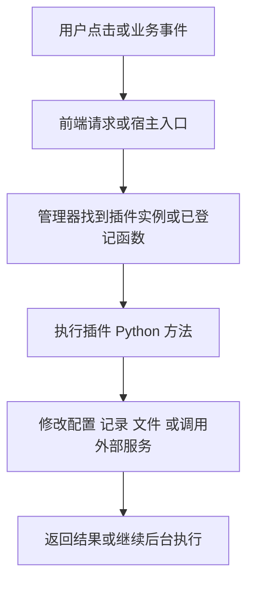

# MoviePilot 插件模块逐项实现详解

**MP 的做法是：把插件代码导入主程序，创建长期存在的 Python 对象，再让页面、定时器、事件和其他业务调用这个对象。** 每个功能的差别，主要在于谁发起调用、传什么数据、保存什么状态，以及什么时候执行。

这份说明从具体操作追到函数和数据变化。每个小节都有触发场景、实际执行链、结果与失败边界；可以按问题直接跳读，不必先阅读所有源码。代码与 JSON 都是机制示意，不是要求你执行的命令。

| 想弄清的问题 | 阅读位置 |
| --- | --- |
| 为什么已经安装却没运行 保存和重载有什么区别 | [1 运行对象和存储](#1-先看清一个插件到底由哪些东西组成) |
| 安装 更新 分身 重置 卸载具体改了什么 | [2 安装更新和管理](#2-安装更新和管理操作怎样改变系统) |
| 表单 详情 文件夹 仪表板和 API 怎样工作 | [3 页面和接口](#3-界面和接口怎样连接到插件) |
| 定时器 事件 命令 工作流 AI 和登录怎样调用插件 | [4 自动执行和扩展](#4-自动执行与系统扩展怎样调用插件) |
| 用同一个例子核对前后变化以及分析范围 | [5 连续操作示例](#5-用同一个例子检查自己是否理解了) |



图中的 E 由具体方法决定：读详情可能只是查询，保存会写配置，定时任务可能访问外部服务。浏览器看到请求结束，并不能推定所有后台业务已经完成。

## 1 先看清一个插件到底由哪些东西组成

文中的示例插件具有一个启用开关、执行周期和执行历史。这些字段由示例插件约定，平台并不要求所有插件使用同一个启用字段。

### 1.1 代码 配置 数据和运行对象各放在哪里

假设你安装了 `Demo`，把周期设为 60 分钟，并已经产生了三条执行历史。MP 不会把这几类东西塞进同一个“插件文件”。

| 东西 | MP 保存的位置 | `Demo` 的示意内容 | 它回答的问题 |
| --- | --- | --- | --- |
| 程序代码 | 主程序根目录下 `app/plugins/demo/` | `__init__.py`、其他 Python 文件、前端构建文件 | 插件会做什么？ |
| 已安装清单 | SystemConfig 中的 `UserInstalledPlugins` | `["Demo"]` | 应用启动时打算加载谁？ |
| 用户配置 | SystemConfig 中的 `plugin.Demo` | `{"enabled": true, "interval": 60}` | 这一次应该怎样运行？ |
| 业务数据和文件 | PluginData 表的 `plugin_id/key/value`；独立的 `CONFIG_PATH/plugins/Demo/` | 数据库里 `history → 三条记录`；目录里可能是缓存文件 | 以前做过什么、保留了哪些材料？ |
| 内存中的类和实例 | `_plugins["Demo"]` 与 `_running_plugins["Demo"]` | 类定义，以及由它创建的对象 | 当前真正可以调用的是哪个对象？ |

表中的数据库数据和目录文件是两种存储。`save_data("history", value)` 写数据库；`get_data_path()` 只取得文件目录，具体写什么文件由插件自己做。配置表和数据表都使用 JSON 值，但键和用途不同。

这里的“类”可以理解为插件的程序定义，“实例”是已经读取配置、可以接收调用的那个运行对象。主程序后续执行任务时，调用的是实例的方法，而不是每次重新启动一个插件程序。

**为什么要先区分它们：** 更新通常改代码；保存设置改配置并更新内存对象；重置清配置和数据库数据；卸载从已安装和运行集合里移除。看到某个文件或某条记录还在，不能单独判断插件是否正在运行。

源码：[管理器两张内存表](/Users/accidia/projects/MoviePilot/app/core/plugin.py:40)、[配置表](/Users/accidia/projects/MoviePilot/app/db/models/systemconfig.py:8)、[插件数据表](/Users/accidia/projects/MoviePilot/app/db/models/plugindata.py:14)、[标准数据目录](/Users/accidia/projects/MoviePilot/app/core/config.py:1005)。

### 1.2 安装后的代码怎样变成可调用的插件

**触发：** MP 正常启动、安装结束，或用户请求重载 `Demo`。

1. `PluginManager.start()` 读取已安装清单；指定单个 ID 时只查这个 ID 的目录。扫描时要求有 `__init__.py`，并跳过不属于目标集合的目录。
2. `_load_selective_plugins()` 调用 `importlib.import_module("app.plugins.demo")`，执行 Python 模块导入。它在模块中寻找具有初始化方法和插件名称等特征的类。
3. 管理器按 `plugin_order` 排序，检查使用等级，然后把类存入 `_plugins["Demo"]`。这一步只说明找到了代码定义。
4. 执行 `obj = Demo()`，再执行 `obj.init_plugin(保存的配置)`。插件在这里设置成员变量，也可能启动自己管理的任务或连接。
5. 初始化返回后，管理器保存 `_running_plugins["Demo"] = obj`，再调用 `obj.get_state()` 决定其事件处理器是否启用；后续服务、API 等注册取得的都是这类实例提供的函数。

下面只是上述顺序的简化表示：

```text
plugin_class = 导入得到的 Demo 类
_plugins["Demo"] = plugin_class
obj = plugin_class()
obj.init_plugin(读取配置("plugin.Demo"))
_running_plugins["Demo"] = obj
按 obj.get_state() 启用或禁用事件处理器
```

**停用为什么也会初始化：** MP 必须先创建对象并读配置，才能问对象现在是否启用。因此停用不是“不导入代码”。配置页和部分 API 仍可能需要这个对象提供数据。

**失败会怎样：** 导入失败会被记录后跳过；`init_plugin()` 抛错时，该次加载不会执行到“保存运行对象”。但是类表可能已经写入。`get_state()` 的异常发生在保存运行对象之后，状态又不同。管理器捕获这些异常，所以外围安装/重载接口的成功不能代替检查运行状态和日志。

源码：[选择性导入](/Users/accidia/projects/MoviePilot/app/core/plugin.py:195)、[实例化与初始化顺序](/Users/accidia/projects/MoviePilot/app/core/plugin.py:72)。

### 1.3 保存设置为什么能改变正在运行的插件

**例子：** 设置弹窗中把周期从 60 改成 15，点击保存。这里说的是网页管理端保存，其他工具的写配置方式另有区别。

1. 前端把表单模型作为 JSON 发送到 `PUT /api/v1/plugin/Demo`。
2. `set_plugin_config()` 调用 `save_plugin_config()`，把新字典保存到 `plugin.Demo`。这是配置整体替换，不是后端自动合并所有旧字段；打开表单时合并默认值是另一条流程。
3. 管理器从 `_running_plugins` 取得原来的对象，调用同一个对象的 `init_plugin(new_config)`。代码文件没有被替换，也没有因此创建新对象。
4. `get_state()` 的结果重新决定事件启用状态，插件 AI 工具缓存被清除；随后 `register_plugin()` 更新该插件的定时任务、命令和 API。
5. 新增或改变的周期任务由调度器按新定义运行。插件若在 `init_plugin()` 内自行创建线程或任务，应自己清理旧资源；平台没有能力自动识别作者任意创建的资源。

示意数据变化：

```text
保存前：数据库 interval=60；运行对象里的 interval=60；旧调度定义
写配置后：数据库 interval=15；运行对象暂时还是旧值
初始化后：对象读取新配置，成员变量变成15
重新注册后：调度器取得新的任务定义
```

**失败会怎样：** 数据先保存，初始化后执行，两者没有被此接口包成一个跨数据库和内存的回滚事务。初始化失败时，已写配置可能保留，运行对象还可能发生部分改变。如果对象根本没加载，管理器初始化方法会直接返回；外围成功提示不是对象已经执行初始化的证明。

另外，Base 的 `update_config()` 只是保存配置；内建 AI 修改配置工具也不走这整条网页保存链。不要把所有“写配置”都解释为自动重新初始化。

源码：[网页保存入口](/Users/accidia/projects/MoviePilot/app/api/endpoints/plugin.py:975)、[在原对象上初始化](/Users/accidia/projects/MoviePilot/app/core/plugin.py:121)、[服务命令 API 重新注册](/Users/accidia/projects/MoviePilot/app/api/endpoints/plugin.py:223)、[配置缓存与数据库](/Users/accidia/projects/MoviePilot/app/db/systemconfig_oper.py:30)。

### 1.4 重载为什么能运行刚换上的代码

Python 导入过一个模块后会把它放进 `sys.modules` 缓存。仅覆盖磁盘上的 `__init__.py`，不等于内存中的旧对象已经变成新版。

`reload_plugin("Demo")` 因此按以下顺序执行：

1. `stop("Demo")` 先禁用这类插件的事件处理器。
2. 调用旧对象的 `close()` 和 `stop_service()`，让插件关闭资源；当前源码中两者位于同一个 `try`，`close()` 抛错会跳过后面的 `stop_service()`，并记录警告。
3. 删除该 ID 的类表和运行实例表记录，清除 `app.plugins.demo` 以及以 `app.plugins.demo.` 开头的子模块缓存，再使导入查找缓存失效。
4. 调用 `start("Demo")`，从当前磁盘代码重新导入、创建新对象，并加载仍然保存着的配置。
5. 发出 `PluginReload` 事件；管理 HTTP 包装层还会重新注册服务、命令和 API，使入口指向新版函数。

所以“保存配置”是让原对象重新读参数，“重载”是用当前代码建立新对象。这两种操作的效果不同。清模块缓存按模块名和带点的子模块前缀匹配，不会因为分身叫 `Demob` 就顺带清掉它。

源码：[停止与缓存清理](/Users/accidia/projects/MoviePilot/app/core/plugin.py:156)、[对象关闭方法](/Users/accidia/projects/MoviePilot/app/core/plugin.py:619)、[重载](/Users/accidia/projects/MoviePilot/app/core/plugin.py:641)、[HTTP 重载包装](/Users/accidia/projects/MoviePilot/app/api/endpoints/plugin.py:560)。

### 1.5 插件怎样读写配置 记录和文件

**配置路径：** `self.get_config()` 默认用当前类名组成 `plugin.Demo`；`update_config(new_dict)` 写回同一个键。`SystemConfigOper` 维护内存缓存并持久化数据库，读取返回深复制的值。因此改了 `get_config()` 返回的字典，还需要显式保存，不会自动改数据库。

**运行记录路径：** `self.save_data("history", records)` 最终调用 `PluginDataOper.save("Demo", "history", records)`。它先查相同 `plugin_id + key` 的记录：有则更新，没有则插入。`get_data("history")` 取这一项的值；不传 key 时，返回的是该插件的数据记录集合，不应假定是已经展开成任意格式的普通字典。同步和异步方法服务于不同调用环境。

**文件路径：** `get_data_path()` 创建或返回 `CONFIG_PATH/plugins/Demo/`，插件再使用普通文件操作保存缓存、图片等。代码目录是 `ROOT_PATH/app/plugins/demo/`，两者不是同一个目录。

最小示意：

```python
config = self.get_config()                 # 用户配置
config["interval"] = 15
self.update_config(config)                # 显式保存，单独这句不等于重载
self.save_data("history", [{"result": "ok"}])  # 数据库运行记录
folder = self.get_data_path()              # 文件目录，尚未自动写任何文件
```

这些方法可以显式传入其他 `plugin_id`；默认按当前类名区分是便利约定，并不是 Python 插件完全不能访问别的资源的隔离边界。

源码：[Base 配置和数据方法](/Users/accidia/projects/MoviePilot/app/plugins/__init__.py:239)、[数据库查后写逻辑](/Users/accidia/projects/MoviePilot/app/db/plugindata_oper.py:12)、[配置深复制](/Users/accidia/projects/MoviePilot/app/db/systemconfig_oper.py:101)。

## 2 安装更新和管理操作怎样改变系统

### 2.1 仓库设置：保存的是来源清单，不是立即安装一批插件

**用户触发。** 插件页打开市场设置弹窗，可以列表增删、编辑、拖动排序，也可以切换到文本模式粘贴多行地址。文本按换行、英文或中文逗号拆开，去掉空白与完全相同的重复项；界面只做 HTTP/HTTPS 开头检查，并不在保存前证明该地址真的包含可用插件。源码：[输入解析](/Users/accidia/projects/MoviePilot-Frontend/src/components/dialog/PluginMarketSettingDialog.vue:39)、[列表操作](/Users/accidia/projects/MoviePilot-Frontend/src/components/dialog/PluginMarketSettingDialog.vue:191)。

**前后端链路。** 打开弹窗调用 system/setting/public/PLUGIN_MARKET；点击保存把列表连接为逗号字符串，POST system/setting/PLUGIN_MARKET。后端管理员权限检查后，调用 settings.update_setting，成功时广播 ConfigChanged。源码：[弹窗读取与保存](/Users/accidia/projects/MoviePilot-Frontend/src/components/dialog/PluginMarketSettingDialog.vue:111)、[设置接口](/Users/accidia/projects/MoviePilot/app/api/endpoints/system.py:892)。

**数据变化。** 设置先经过类型转换，再写入 SystemUtils.get_env_path() 所指向的 app.env，并更新进程内 settings。它不是把仓库下载到本地，也不往 UserInstalledPlugins 追加任何插件。源码：[持久化配置](/Users/accidia/projects/MoviePilot/app/core/config.py:859)、[更新内存值](/Users/accidia/projects/MoviePilot/app/core/config.py:904)。

**完成后怎么使用。** 弹窗发出 save，父页刷新已安装列表、市场列表和统计；下次查询市场时按新仓库清单获取索引。仓库顺序有实际意义：两个来源提供相同插件、相同版本时，靠前的在线仓库优先。源码：[保存后刷新](/Users/accidia/projects/MoviePilot-Frontend/src/views/plugin/PluginCardListView.vue:925)、[来源排序](/Users/accidia/projects/MoviePilot/app/core/plugin.py:1572)。

**例子与失败边界。** 保存“仓库 A,仓库 B”只是允许从这两个来源发现插件；插件仍需单独点击安装。如果 PLUGIN_MARKET 已通过进程环境变量设置，后端拒绝用界面覆盖并要求修改环境变量；前端业务失败会提示，网络异常分支主要记录到控制台。源码：[环境变量优先](/Users/accidia/projects/MoviePilot/app/core/config.py:873)、[界面响应](/Users/accidia/projects/MoviePilot-Frontend/src/components/dialog/PluginMarketSettingDialog.vue:124)。

### 2.2 从 Wiki 同步仓库：立即合并保存，不是一个未提交的预览

**用户触发。** 市场设置里的同步按钮调用 POST system/setting/PLUGIN_MARKET/sync-wiki。请求成功后，弹窗用返回的 repos 替换当前编辑列表，并显示新增与总数；这个按钮本身已经让后端保存配置，不必再点普通保存才生效。源码：[同步按钮处理](/Users/accidia/projects/MoviePilot-Frontend/src/components/dialog/PluginMarketSettingDialog.vue:142)、[服务端保存](/Users/accidia/projects/MoviePilot/app/api/endpoints/system.py:847)。

**后端取什么。** 默认请求 MoviePilot-Wiki 的 plugin.md，只接受 HTTPS、raw.githubusercontent.com 和指定 Wiki 项目的 plugin.md 路径。服务端不是执行 Markdown，而是从文本中提取 GitHub 仓库链接。源码：[地址范围检查](/Users/accidia/projects/MoviePilot/app/api/endpoints/system.py:122)、[默认源与解析规则](/Users/accidia/projects/MoviePilot/app/helper/market.py:6)。

**怎样合并。** 文档若有唯一且顺序正确的 plugin-market-repos 开始/结束标记，只解析标记内内容；当前接口没有强制标记，因此没有合格标记时会扫描全文。链接被规范化为 HTTPS GitHub 仓库根地址，并按不区分大小写的形式去重，保留原配置顺序后追加 Wiki 新项目。源码：[标记与提取](/Users/accidia/projects/MoviePilot/app/helper/market.py:51)、[合并](/Users/accidia/projects/MoviePilot/app/helper/market.py:84)。

**例子与落盘。** 已保存 A、B，Wiki 给出 B、C，结果为 A、B、C；接口返回 added_count、total_count、repos，同时通过普通 settings 更新流程写 app.env、更新内存和发送配置变更事件。同步不会安装 C 仓库内的插件。源码：[接口完整流程](/Users/accidia/projects/MoviePilot/app/api/endpoints/system.py:816)。

**失败边界。** 源不可访问、非 200、没有识别到仓库都返回业务失败，未进入保存阶段。规范化也作用于原有地址：非 GitHub 地址会被过滤，带额外路径的 GitHub 地址会被归一到仓库根；因此不能把“合并”理解为逐字保留原字符串。此处关闭弹窗不能撤销已经完成的 Wiki 同步。源码：[响应检查](/Users/accidia/projects/MoviePilot/app/api/endpoints/system.py:835)、[规范化与原清单拆分](/Users/accidia/projects/MoviePilot/app/helper/market.py:17)。

### 2.3 市场列表：后端把索引加工成卡片，前端再做搜索和筛选

**用户触发。** 进入插件页时，前端分别请求 plugin/?state=installed 和 plugin/?state=market。前者拿现有插件卡片，后者拿候选市场卡片；并不是一个接口返回所有代码或所有配置。源码：[已安装请求](/Users/accidia/projects/MoviePilot-Frontend/src/views/plugin/PluginCardListView.vue:788)、[市场请求](/Users/accidia/projects/MoviePilot-Frontend/src/views/plugin/PluginCardListView.vue:813)。

**如何取索引。** 后端拆分 PLUGIN_MARKET，每个仓库请求 package.json，以及当前 VERSION_FLAG 对应的 package.<flag>.json。索引是一份“插件 ID → 名称、版本、描述等”的 JSON 字典；基础索引里的条目还需明确声明兼容当前版本标记。源码：[并发读取各索引](/Users/accidia/projects/MoviePilot/app/core/plugin.py:1725)、[索引下载与解析](/Users/accidia/projects/MoviePilot/app/helper/plugin.py:487)、[基础索引兼容过滤](/Users/accidia/projects/MoviePilot/app/core/plugin.py:1608)。

**加工了哪些信息。** 管理器把索引元数据转换成统一 Plugin 对象，补上 repo_url、installed、state、has_update、历史记录、系统兼容结果和授权等级。installed 不只是查数据库，还要求该 ID 有已加载类；state 则询问运行实例。源码：[市场条目生成](/Users/accidia/projects/MoviePilot/app/core/plugin.py:1608)、[本地卡片生成](/Users/accidia/projects/MoviePilot/app/core/plugin.py:1375)。

**完成后怎么显示。** market 返回未安装候选及已安装但有更新的候选。前端把更新候选的来源、历史和兼容提示补到同 ID 的已安装卡片，再从普通市场展示列表排除这些“已安装且可更新”条目，避免它们同时占据市场安装卡片位置。源码：[后端列表组合](/Users/accidia/projects/MoviePilot/app/api/endpoints/plugin.py:343)、[前端更新信息回填](/Users/accidia/projects/MoviePilot-Frontend/src/views/plugin/PluginCardListView.vue:827)。

**例子与失败边界。** Foo 已安装 1.0，市场提供 1.1，则 Foo 的已安装卡片出现更新信息；只有索引的 Bar 不会自动变成运行实例。加载失败可能造成“数据库有 ID，卡片却缺席”；后台读取市场失败也可能最终表现为空列表，不能把空列表直接解释成仓库确实没有插件。源码：[installed 判断](/Users/accidia/projects/MoviePilot/app/core/plugin.py:1640)、[市场错误折叠](/Users/accidia/projects/MoviePilot/app/core/plugin.py:1526)。

### 2.4 多来源选版本：版本优先，相同版本才看来源顺序

**触发与输入。** 每次市场查询或启动同步都会调用 process_plugins_list，输入可以同时包含多个在线仓库与本地仓库候选；“高版本索引”参数指 package.<flag>，不代表其中每个插件版本都必然更高。源码：[聚合调用](/Users/accidia/projects/MoviePilot/app/api/endpoints/plugin.py:363)、[合并入口](/Users/accidia/projects/MoviePilot/app/core/plugin.py:1558)。

**核心算法。** 先合并版本索引与基础索引，去掉相同 ID/版本的重复基础条目；再按来源顺序稳定去重，最后每个 ID 只保留版本比较结果最大的候选。相同版本在线来源优于 local://，在线来源之间按 PLUGIN_MARKET 的顺序。源码：[合并与择优](/Users/accidia/projects/MoviePilot/app/core/plugin.py:1566)。

    A: Foo 1.0；B: Foo 1.2；本地: Foo 1.1  → Foo 1.2，来自 B
    A: Foo 1.2；B: Foo 1.2；本地: Foo 1.2  → Foo 1.2，来自 A

上面的例子意味着仓库排第一不能压住另一个仓库的更高版本；只有同版本冲突才优先靠前来源。版本比较使用项目自己的 StringUtils.compare_version，不应直接假设是完整 SemVer 规则。源码：[同 ID 选择](/Users/accidia/projects/MoviePilot/app/core/plugin.py:1592)、[版本比较实现](/Users/accidia/projects/MoviePilot/app/utils/string.py:808)。

**数据与后续作用。** 聚合只改变返回候选对象，不改本地文件；选中来源随后成为卡片的 repo_url，用户点更新时传回安装接口。安装者因此拿到的是明确选中的来源，而不是安装时再随机取一个同名插件。源码：[来源注入](/Users/accidia/projects/MoviePilot/app/core/plugin.py:1701)、[更新传递来源](/Users/accidia/projects/MoviePilot-Frontend/src/components/cards/PluginCard.vue:232)。

**失败边界。** 版本优选和系统兼容标记是分开的：最高版本不兼容时可以仍作为卡片出现并禁用安装；启动同步会跳过不兼容候选，源码没有“自动改选较低兼容版本”的二次搜索。源码：[兼容字段保留](/Users/accidia/projects/MoviePilot/app/core/plugin.py:1652)、[启动候选过滤](/Users/accidia/projects/MoviePilot/app/core/plugin.py:720)。

### 2.5 刷新市场：刷新的是索引，不是把插件升级一遍

**用户与定时触发。** 点击市场刷新，前端调用 fetchUninstalledPlugins(true)，再读取统计。后台还有每 30 分钟一次的 plugin_market_refresh，目标函数是 async_get_online_plugins(force=True)，不是 PluginManager.sync 或安装器。源码：[手动刷新](/Users/accidia/projects/MoviePilot-Frontend/src/views/plugin/PluginCardListView.vue:931)、[定时目标](/Users/accidia/projects/MoviePilot/app/scheduler.py:488)、[调度间隔](/Users/accidia/projects/MoviePilot/app/scheduler.py:707)。

**缓存变化。** 普通索引读取缓存 1800 秒；force 通过 fresh 上下文绕过缓存，并在请求 URL 加刷新参数以减少远端缓存影响。多个仓库请求并发执行，完成后仍按任务原始顺序整理结果，避免网络快慢改变同版本来源顺序。源码：[索引缓存](/Users/accidia/projects/MoviePilot/app/helper/plugin.py:487)、[刷新参数](/Users/accidia/projects/MoviePilot/app/helper/plugin.py:387)、[异步结果排序](/Users/accidia/projects/MoviePilot/app/core/plugin.py:1725)。

**完成后怎么使用。** 最新索引参与版本比较，前端据此更新卡片、过滤项和更新按钮；这一步既不覆盖 app/plugins 下的文件，也不调用插件 init_plugin。真正升级还需要后续安装流程或启动同步。源码：[市场结果回填](/Users/accidia/projects/MoviePilot-Frontend/src/views/plugin/PluginCardListView.vue:827)、[市场请求函数](/Users/accidia/projects/MoviePilot/app/core/plugin.py:1725)。

**失败边界。** 404 索引被视为空字典，网络或其他异常返回 None，再由管理器转成空列表并记录日志。刷新进度表示“请求处理完了多少”，所有请求失败也可能到 100%；这不是每个仓库健康通过的证明。源码：[HTTP 结果区分](/Users/accidia/projects/MoviePilot/app/helper/plugin.py:487)、[失败转空](/Users/accidia/projects/MoviePilot/app/core/plugin.py:1543)、[进度递增](/Users/accidia/projects/MoviePilot/app/core/plugin.py:1785)。

### 2.6 安装：先把代码放好，再登记和创建运行实例

**用户触发。** 市场详情“安装到本地”先检查 system_version_compatible；允许安装才显示等待弹窗，GET plugin/install/<ID>，携带 repo_url，force 取卡片 has_update。成功时关闭弹窗、提示并刷新列表；这个等待提示不等于实时逐文件安装进度。源码：[详情安装处理](/Users/accidia/projects/MoviePilot-Frontend/src/components/dialog/PluginMarketDetailDialog.vue:100)。

**后端第一处分支。** 管理员鉴权后，若该 ID 的类已经存在且不是 force，接口不重新下载，仅做可选兼容性检查和统计；否则必须有 repo_url，交给 PluginHelper.async_install。因而“点击安装”可能是把本地已有代码重新登记，不必每次联网下载。源码：[接口分支](/Users/accidia/projects/MoviePilot/app/api/endpoints/plugin.py:576)。

**真正安装时的数据变化。** helper 先找适用 package，再决定 Release ZIP 或仓库文件列表；统一流程备份旧代码（仅非 force）、清理目标目录、放入新内容、处理依赖，目标是 app/plugins/<ID小写>。成功后才把原 ID 追加到 UserInstalledPlugins，原有 ID 不重复追加。源码：[来源与方式选择](/Users/accidia/projects/MoviePilot/app/helper/plugin.py:620)、[异步文件替换流程](/Users/accidia/projects/MoviePilot/app/helper/plugin.py:2805)、[登记安装清单](/Users/accidia/projects/MoviePilot/app/api/endpoints/plugin.py:614)。

**随后如何生效。** API 调用 reload_plugin：停止旧实例、清除该模块及子模块缓存、重新导入、创建对象、读取原配置并初始化，然后更新任务、命令和 API。代码安装本身不清除配置或 PluginData；新实例能继续读取同 ID 原有配置。源码：[重载](/Users/accidia/projects/MoviePilot/app/core/plugin.py:641)、[启动与初始化](/Users/accidia/projects/MoviePilot/app/core/plugin.py:72)、[服务注册](/Users/accidia/projects/MoviePilot/app/api/endpoints/plugin.py:223)。

**例子与失败边界。** Foo 安装成功后目录存在、ID 已登记，随后导入缺依赖或 init_plugin 抛错仍可能没有可用实例。管理器捕获初始化异常，而安装入口没有再次核验运行实例就返回 success；必须区分“文件安装完成”与“插件业务已正常工作”。源码：[初始化异常捕获](/Users/accidia/projects/MoviePilot/app/core/plugin.py:104)、[接口成功返回](/Users/accidia/projects/MoviePilot/app/api/endpoints/plugin.py:621)。

### 2.7 Release 与历史：更新日志、可下载资产和指定版本是三件事

**界面能做什么。** 当前前端版本历史弹窗请求 plugin/history/<ID>?force=true，显示 package 中的 history；有更新操作时，只提供“更新到最新版”。全 src 检索未发现 plugin/releases 或 release_version 调用，因此此检出不能写成已实现“界面任选历史版本恢复”。源码：[历史读取](/Users/accidia/projects/MoviePilot-Frontend/src/components/dialog/PluginVersionHistoryDialog.vue:48)、[唯一更新动作](/Users/accidia/projects/MoviePilot-Frontend/src/components/dialog/PluginVersionHistoryDialog.vue:102)。

**后端另有 API 能力。** plugin/releases/<ID> 接受 repo_url，只查询指定仓库的元数据和 GitHub Release；返回 current_version、latest_version、items。每个可安装版本必须有形如 Foo_v1.2 的标签及对应小写 foo_v1.2.zip 资产；仅写了 history["1.2"] 不会自动变成可下载安装包。源码：[Release API](/Users/accidia/projects/MoviePilot/app/api/endpoints/plugin.py:428)、[资产筛选](/Users/accidia/projects/MoviePilot/app/helper/plugin.py:418)。

**指定版本怎么装。** API 调用者可向 install 传 release_version；安装器先验证当前索引声明 release、目标版本确有可安装资产，再只下载这个标签。旧版本选择不会套用“当前最新版”的 system_version 范围，选中的版本等于当前索引版本时才使用该范围检查。源码：[指定版本分支](/Users/accidia/projects/MoviePilot/app/helper/plugin.py:678)。

    普通安装最新：Release 失败 → 清理部分文件 → 尝试仓库文件列表
    明确安装 1.2：1.2 资产不存在或下载失败 → 返回失败，不偷偷装最新版

这两条规则让“发布索引早于打包完成”的普通安装可继续，又避免指定旧版时装错版本。已有类的非 force 分支会跳过下载安装，所以对已安装插件指定版本还需 force 才会真正替换代码。源码：[两类回退差异](/Users/accidia/projects/MoviePilot/app/helper/plugin.py:678)、[已存在短路分支](/Users/accidia/projects/MoviePilot/app/api/endpoints/plugin.py:591)。

**查询失败与缓存边界。** 没有 repo_url、未声明 Release 或没有合格资产时，接口可返回 release_supported=false 与空列表。force 且已有 Release 缓存时，本次先返回缓存，再安排后台刷新，不保证本次响应就是刚从 GitHub 获取的内容。源码：[Release 返回语义](/Users/accidia/projects/MoviePilot/app/api/endpoints/plugin.py:440)、[后台刷新](/Users/accidia/projects/MoviePilot/app/api/endpoints/plugin.py:462)。

### 2.8 兼容性与依赖：判断能否安装，以及让代码具备运行条件

**作者提供什么。** package 元数据可以声明 system_version，例如“>=2.0,<3.0”；插件目录可放 requirements.txt 声明需要的 Python 包。前者针对 MoviePilot 主程序版本，后者针对运行库，它们不是同一种版本约束。源码：[系统范围检查](/Users/accidia/projects/MoviePilot/app/helper/plugin.py:160)、[依赖文件定位](/Users/accidia/projects/MoviePilot/app/helper/plugin.py:903)。

**检查链路。** 市场查询把兼容结果和原因传给前端；前端阻止明显不兼容的安装，后端安装时仍重新检查。system_version 缺省允许通过，字符串格式非法、系统版本不可解析或范围不满足则返回原因；不能靠只修改前端字段绕过后端。源码：[卡片兼容字段](/Users/accidia/projects/MoviePilot/app/core/plugin.py:1652)、[安装检查](/Users/accidia/projects/MoviePilot/app/helper/plugin.py:697)、[前端阻止](/Users/accidia/projects/MoviePilot-Frontend/src/components/cards/PluginCard.vue:222)。

**依赖怎样进入系统。** 仓库文件方式先尝试下载并预安装 requirements，再下载其他文件；统一安装流程最后再次处理依赖。pip_install_with_fallback 优先考虑本地 wheels，并用全局锁、约束文件、受保护运行依赖与安装前后健康检查控制冲突；安装目标是宿主 Python 环境，不是每插件虚拟环境。源码：[文件列表准备](/Users/accidia/projects/MoviePilot/app/helper/plugin.py:2842)、[统一依赖步骤](/Users/accidia/projects/MoviePilot/app/helper/plugin.py:1762)、[pip 策略](/Users/accidia/projects/MoviePilot/app/helper/plugin.py:1494)。

**完成后怎么使用。** 安装包进入 Python 运行环境后，插件 import 对应库才有条件成功，管理器随后创建实例。例如 Foo 依赖某 HTTP 库，复制 Foo 的 Python 文件并不能替代该依赖；仍需依赖检查与真实初始化。源码：[依赖执行](/Users/accidia/projects/MoviePilot/app/helper/plugin.py:903)、[实例创建](/Users/accidia/projects/MoviePilot/app/core/plugin.py:106)。

**失败边界。** 预安装失败可暂时记录后继续下载，但最终统一依赖步骤失败会使安装失败。发现新增运行环境健康问题会尝试修复宿主依赖，即便修复成功，也不把这一轮受损安装当作成功；旧代码备份恢复只恢复文件，不是对整个 Python 环境做事务回滚。源码：[预安装与继续下载](/Users/accidia/projects/MoviePilot/app/helper/plugin.py:2847)、[依赖失败回退](/Users/accidia/projects/MoviePilot/app/helper/plugin.py:1762)、[健康回归处理](/Users/accidia/projects/MoviePilot/app/helper/plugin.py:1576)。

### 2.9 更新：原 ID 原目录替换，再让同一个配置驱动新代码

**用户触发。** 已安装卡片的更新按钮或历史弹窗“更新到最新版”，最终进入 PluginCard.updatePlugin。它请求 install/<ID> 并固定 force=true，repo_url 来自市场补充的来源；没有独立的“增量补丁更新接口”。源码：[更新按钮实现](/Users/accidia/projects/MoviePilot-Frontend/src/components/cards/PluginCard.vue:222)、[来源回填](/Users/accidia/projects/MoviePilot-Frontend/src/views/plugin/PluginCardListView.vue:827)。

**具体替换。** 例如 Foo 从 1.0 升 1.2，安装器删 app/plugins/foo，写入 1.2 的代码和资产；同 ID 已在安装清单中就不追加。平台没有先停止旧实例再下载的独立阶段，正常入口是 helper 完成文件安装后才调用 reload_plugin 停旧启新。源码：[异步安装步骤](/Users/accidia/projects/MoviePilot/app/helper/plugin.py:2805)、[先安装后重载](/Users/accidia/projects/MoviePilot/app/api/endpoints/plugin.py:602)。

**运行如何切换。** 重载清除的是 app.plugins.foo 和以它加点号开头的子模块，重新导入新代码；保存配置仍取 plugin.Foo，插件自己在 init_plugin 中解释旧配置。关闭逻辑先 close 再 stop_service，两者在同一 try 中，close 抛错会跳过 stop_service。源码：[模块清理边界](/Users/accidia/projects/MoviePilot/app/core/plugin.py:654)、[配置读取](/Users/accidia/projects/MoviePilot/app/core/plugin.py:776)、[关闭顺序](/Users/accidia/projects/MoviePilot/app/core/plugin.py:619)。

**完成后的表现。** 接口 success 后前端提示更新成功并发出 save，让父页重读卡片；真正的新版本号来自新加载类/市场信息。平台不会替作者自动迁移任意业务数据格式，不能把保留配置理解为所有旧配置都与新实现兼容。源码：[更新界面反馈](/Users/accidia/projects/MoviePilot-Frontend/src/components/cards/PluginCard.vue:242)、[新类初始化](/Users/accidia/projects/MoviePilot/app/core/plugin.py:104)。

**force 的精确含义。** 此处 force 同时让接口不走“已有类就不下载”的捷径，并让安装器跳过临时旧代码备份。下载或最终依赖失败时，没有备份则清理目标目录，不能承诺自动恢复 1.0；后续初始化失败也不触发安装器回滚。源码：[接口 force](/Users/accidia/projects/MoviePilot/app/api/endpoints/plugin.py:591)、[force 跳过备份及失败清理](/Users/accidia/projects/MoviePilot/app/helper/plugin.py:2805)。

### 2.10 分身 怎样让同一份插件变成两份独立实例

**例子：** 已有 `Demo` 1.0，配置是 `{"enabled": true, "interval": 60}`。用户在分身弹窗填后缀 `B`，点击创建。前端请求 `POST /api/v1/plugin/clone/Demo`，请求体包含 `suffix/name/description/version/icon`。

1. **分配身份。** `PluginManager.clone_plugin()` 生成 `clone_id = "Demo" + "b"`，得到 `Demob`。后端检查原插件是否存在、新身份是否占用、原目录是否存在。
2. **复制代码。** `shutil.copytree()` 把整个 `ROOT_PATH/app/plugins/demo/` 复制成 `ROOT_PATH/app/plugins/demob/`。此时两份目录中的代码最初相同；分身并不是指向原目录的链接。
3. **改写副本。** `_modify_plugin_files()` 修改副本的主文件：把类名改为 `Demob`，改配置前缀，按用户输入改名称、描述、版本和图标，并在匹配到精确文本 `def init_plugin(self` 时插入 `is_clone=True`。如果存在 `dist`，还会对 JS/CSS 中的相关名称做替换，并尝试改构建文件名。这是字符串/正则替换，不是对整个程序做语义重构。
4. **建立配置和清单。** 把 `Demob` 加入已安装清单。原配置非空时复制一份到 `plugin.Demob`，再写 `enable=false`、`enabled=false`；原配置为空时不写这份复制配置。PluginData 表中的历史记录不随此步骤复制。
5. **加载并接入。** 创建/初始化分身对象；管理 API 包装层再走重载注册，把 API、任务、命令接入。原插件在文件夹中时，将分身加入其所在的第一个文件夹。源码中这条创建路径有再次初始化/重载的步骤，作者不能假定初始化只调用一次。

创建完成后的对应关系如下：

| 项目 | 原插件 | 分身 |
| --- | --- | --- |
| ID 和类名 | `Demo` | `Demob` |
| 代码目录 | `app/plugins/demo/` | `app/plugins/demob/` |
| 配置键 | `plugin.Demo` | `plugin.Demob` |
| 数据表标识与默认文件目录 | `plugin_id=Demo`；`plugins/Demo/` | `plugin_id=Demob`；`plugins/Demob/` |
| 运行对象 | `_running_plugins["Demo"]` | `_running_plugins["Demob"]` |

**为什么配置能独立：** Base 默认从 `self.__class__.__name__` 取得 ID。新类名不同，配置键、数据库数据键和标准数据目录随之不同。API 注册时也会加上当前插件 ID，因此 `/plugin/Demo/...` 与 `/plugin/Demob/...` 能对应不同实例。

**独立到什么程度：** 不会自动复制 PluginData 数据；标准外部数据目录也没有统一复制步骤。但代码目录里的文件会被 `copytree` 一起复制。插件如果把路径、远端账户、命令或业务标识硬编码在代码里，改类名不保证这些内容也全部隔离。两份插件仍共享 MP 的 Python 依赖环境。

**失败会怎样：** 副本主文件改写失败时会删除刚创建的目录；后续步骤整体没有事务回滚。部分联邦资源改写失败只记录警告；初始化也可能由加载器捕获错误。因此应检查是否真的建立运行对象，不能只看复制目录成功。

**原插件更新后分身会不会跟着变：** 不会由平台自动跟随。更新 `Demo` 只替换 `demo/` 并重载 `Demo`；`demob/` 是自己的副本。分身可自定义的版本号是代码元数据，改它也不会下载某个对应版本。

源码：[分身 HTTP 入口](/Users/accidia/projects/MoviePilot/app/api/endpoints/plugin.py:933)、[复制与配置](/Users/accidia/projects/MoviePilot/app/core/plugin.py:1905)、[Python 改写](/Users/accidia/projects/MoviePilot/app/core/plugin.py:2061)、[联邦资源改写](/Users/accidia/projects/MoviePilot/app/core/plugin.py:2139)。

### 2.11 重置 怎样清除设置和运行记录但保留插件

**例子：** 用户想把 `Demo` 恢复成重新配置的状态，点击重置并确认。前端调用 `GET /api/v1/plugin/reset/Demo`。

1. 后端先发送同步 `PluginDataReset` 事件，数据包含 `plugin_id=Demo`、`reset_config=true`、`reset_data=true`。处理器此时还能访问运行对象和旧数据，可以做自身需要的补偿。
2. `stop("Demo")` 禁用事件处理器，请求旧实例清理资源并移除管理器引用；这一步不保证等待或取消所有在途调用和已绑定的旧回调。
3. 删除 `plugin.Demo` 配置，并删除 PluginData 中 `plugin_id=Demo` 的全部记录；因为类可能已在停止时清掉，删除使用 `force=True`。
4. 再次加载 `Demo`，把缺失配置的状态交给插件初始化；表单默认值如何显示由 `get_form()` 和插件初始化决定。
5. 重新注册服务、命令和 API，返回响应，前端刷新当前插件状态。

**实际变化：** 代码仍在、已安装清单仍包含 `Demo`，旧配置和数据库历史被清除。接口没有直接递归删除 `CONFIG_PATH/plugins/Demo/`；具体插件的重置处理器可以另做清理。同步重置事件也不是一个统一的“否决重置”机制：这个接口没有读取返回的 `cancel` 来跳过后面的删除。

**失败边界：** 事件、停止、删除、重新加载分多个步骤执行，没有包成整体事务；完成了前几步后发生错误，不意味着已删除的配置和数据会自动恢复。

源码：[重置顺序](/Users/accidia/projects/MoviePilot/app/api/endpoints/plugin.py:739)、[重置事件数据模型](/Users/accidia/projects/MoviePilot/app/schemas/event.py:67)、[配置和数据删除](/Users/accidia/projects/MoviePilot/app/core/plugin.py:815)。

### 2.12 卸载 怎样让插件退出系统以及为什么还有残留文件

**触发：** 点击卸载并确认，发送 `DELETE /api/v1/plugin/Demo`。

1. 从 `UserInstalledPlugins` 中移除请求的 ID，保存清单；以后普通启动不再按这份清单加载它。
2. 从 FastAPI 路由中移除该 ID 的插件 API，从调度器中移除该插件的公共任务。
3. 检查当前类的 `is_clone`。是分身时，额外删除配置、PluginData 记录和分身代码目录；普通插件不走这段删除。
4. 从插件文件夹配置中移除它，再通过 `remove_plugin()` 停止对象、清除类/运行表和模块缓存。
5. 返回卸载响应，前端从已安装列表移除卡片。

| 操作 | 代码 | 已安装清单 | 配置和数据库业务数据 | 标准文件数据目录 |
| --- | --- | --- | --- | --- |
| 普通插件卸载 | 保留 | 移除 ID | 保留 | 此接口不统一递归删除 |
| 已正确识别的分身卸载 | 删除分身代码 | 移除 ID | 删除分身配置和数据 | 此接口不统一递归删除 |
| 插件重置 | 保留 | 保留 ID | 删除 | 此接口不统一递归删除 |

**为什么原插件重装后可能找回配置：** 普通卸载有意没有在此入口删除配置。只要插件 ID 仍是原来的 ID，重新加载就会再次读取原配置；实际能否继续使用还取决于新版插件的数据兼容处理。

**失败边界：** 分身身份从当前类读取，不是仅靠名字后缀猜测。类没有加载时不能据此认定一定执行分身专属删除；目录删除失败也可能只记录错误而继续返回成功。插件停止逻辑只负责调用作者的清理方法，不能保证作者创建的任意外部资源都被释放。

源码：[卸载完整分支](/Users/accidia/projects/MoviePilot/app/api/endpoints/plugin.py:992)、[移除实例](/Users/accidia/projects/MoviePilot/app/core/plugin.py:634)、[API 路由移除](/Users/accidia/projects/MoviePilot/app/api/endpoints/plugin.py:183)。

### 2.13 本地仓库：开发目录也是一种明确的安装来源

**用户与作者入口。** 系统高级设置的开发页有 PLUGIN_LOCAL_REPO_PATHS 路径输入；保存时经 saveAdvancedSettings → saveSystemSetting → POST system/env。作者把源代码和 package 索引放在该路径下，路径属于运行 MoviePilot 的机器或容器，而不是浏览器所在电脑。源码：[开发设置控件](/Users/accidia/projects/MoviePilot-Frontend/src/views/setting/AccountSettingSystem.vue:2358)、[保存链](/Users/accidia/projects/MoviePilot-Frontend/src/views/setting/AccountSettingSystem.vue:681)、[批量设置后端](/Users/accidia/projects/MoviePilot/app/api/endpoints/system.py:731)。

**目录契约。** 多路径用逗号分开，展开用户目录，非绝对路径相对 ROOT_PATH，再规范化。一个候选需要 package.v2.json 与 plugins.v2/foo 这样的索引/目录配对，或基础 package.json、plugins/foo 且声明兼容当前标记。扫描不是随意搜索所有 Python 文件。源码：[路径处理](/Users/accidia/projects/MoviePilot/app/helper/plugin.py:209)、[候选扫描](/Users/accidia/projects/MoviePilot/app/helper/plugin.py:252)。

**市场如何识别来源。** 管理器将候选转成 local://<ID>?path=...&version=... 来源，再参与同一市场聚合。点击本地卡片仍走 install 接口；helper 识别 local:// 后，校验 ID、已配置根路径、package 分支与系统版本，然后复制到运行目录。源码：[本地市场对象](/Users/accidia/projects/MoviePilot/app/core/plugin.py:1462)、[来源查找](/Users/accidia/projects/MoviePilot/app/helper/plugin.py:313)、[本地安装](/Users/accidia/projects/MoviePilot/app/helper/plugin.py:725)。

**文件变化与后续。** copytree 复制源目录，忽略 pycache、pyc、.DS_Store 和 node_modules，随后走与远程安装相同的依赖处理、登记和重载。它是运行副本，不是让实例直接在作者仓库路径执行；没有启用热加载时，改源文件不会自动改运行副本。源码：[本地复制及统一流程](/Users/accidia/projects/MoviePilot/app/helper/plugin.py:747)、[监听启用条件](/Users/accidia/projects/MoviePilot/app/core/plugin.py:289)。

**例子与失败边界。** 将开发根配置为 /demo/plugins-repo 后，只允许它参与候选选择；手工拼出别的 path 并不能任意加载。缺索引、目录不存在、ID 不符、不兼容、来源就是运行目录都会不能正常安装。本地市场同版本仍可能让在线来源胜出，所以“配置了本地路径”不等于覆盖所有同名在线版本。源码：[配置根约束](/Users/accidia/projects/MoviePilot/app/helper/plugin.py:323)、[安装拒绝条件](/Users/accidia/projects/MoviePilot/app/helper/plugin.py:729)、[来源优先级](/Users/accidia/projects/MoviePilot/app/core/plugin.py:1574)。

### 2.14 源码热重载：文件事件触发复制与重新导入

**用户触发与开关。** 开发页提供 PLUGIN_AUTO_RELOAD；后端在 DEV 或该开关为 true 时启动监控线程。相关配置改变会重新建立监控；如果两项都关闭则停止监控，关闭 AUTO_RELOAD 但保留 DEV=true 仍会监控。源码：[前端开关](/Users/accidia/projects/MoviePilot-Frontend/src/views/setting/AccountSettingSystem.vue:2383)、[监控开关逻辑](/Users/accidia/projects/MoviePilot/app/core/plugin.py:289)。

**普通 Python 文件链路。** watchfiles 监视运行插件目录与当前存在的本地根目录。运行目录的 .py 变化只触发重载；外部本地仓库 .py 变化先识别候选，确认已安装，再把源目录同步到运行目录，然后重载。2 秒近期同步记录用来抑制复制引发的重复运行目录事件。源码：[事件分类](/Users/accidia/projects/MoviePilot/app/core/plugin.py:335)、[已安装同步](/Users/accidia/projects/MoviePilot/app/core/plugin.py:582)。

    保存开发仓库的 foo/__init__.py
      → 找到 Foo 候选 → 确认 Foo 已安装 → 复制运行副本
      → stop(Foo) → 清导入缓存 → start(Foo) → 广播 PluginReload

这条链使下一次调用拿到新建的插件实例，不只是重读配置。DEV 模式放宽监听候选的系统版本约束，但正常安装的兼容检查仍存在；不能把开发模式理解为任何安装路径都忽略兼容性。源码：[监听候选模式](/Users/accidia/projects/MoviePilot/app/core/plugin.py:543)、[重载](/Users/accidia/projects/MoviePilot/app/core/plugin.py:641)。

**特殊文件怎么处理。** requirements.txt 变化只提示重新安装依赖，不自动启动 pip；普通非 .py 文件跳过。Vue 联邦构建产物另有识别：入口完整时可同步外部仓库产物，但不重载 Python 后端；这避免前端每次构建都重启后台任务。源码：[依赖和联邦产物分支](/Users/accidia/projects/MoviePilot/app/core/plugin.py:363)。

**停止与失败边界。** 停止监控会设停止事件并等待最多 5 秒，仍存活只警告；重载异常逐个记录。同步并不是新插件自动发现即安装，未在安装清单的候选不会复制；代码写坏后，新实例可能初始化失败，热重载没有保存上个可用实例的事务回退机制。源码：[停止监控](/Users/accidia/projects/MoviePilot/app/core/plugin.py:320)、[同步过滤](/Users/accidia/projects/MoviePilot/app/core/plugin.py:582)、[重载错误处理](/Users/accidia/projects/MoviePilot/app/core/plugin.py:421)。

### 2.15 启动修复：先尽量启动现有插件，再后台补齐和更新

**触发方式。** 这是应用启动链路，不是插件页上的独立“修复全部”按钮。正常启动先执行 Docker 插件恢复，接着加载插件、定时器、监控、命令和工作流，再创建后台 init_extra 任务；HTTP 服务可以在后台同步尚未结束时开始运行。源码：[生命周期启动顺序](/Users/accidia/projects/MoviePilot/app/startup/lifecycle.py:73)。

**后台选择什么。** init_extra → sync_plugins → PluginManager.sync。sync 合并在线和本地最高候选，仅考虑已安装 ID、系统兼容、当前插件不存在或版本较旧的条目，最多 5 个并发 force 安装；不会把整个市场都安装一遍，也不会因市场版本较低而自动降级。源码：[后台入口](/Users/accidia/projects/MoviePilot/app/startup/lifecycle.py:41)、[候选与并发](/Users/accidia/projects/MoviePilot/app/core/plugin.py:690)、[存在与版本判断](/Users/accidia/projects/MoviePilot/app/core/plugin.py:1495)。

**数据变化与重新使用。** 同步成功覆盖相关代码；随后检测整个插件环境缺失/不兼容的依赖。只要同步列表或依赖检测列表非空，就 stop/start 所有插件、重注册 API，外层再注册插件定时服务和重启命令，让它们指向新对象。源码：[同步后整体重建](/Users/accidia/projects/MoviePilot/app/startup/plugins_initializer.py:6)、[任务与命令刷新](/Users/accidia/projects/MoviePilot/app/startup/lifecycle.py:49)。

**例子与失败边界。** 数据库记着 Foo 已安装，但容器内没有 Foo，启动同步可从可用来源补装。网络失败、索引无候选、授权过滤等都可能使它仍缺失；依赖检测函数即便安装依赖失败也返回检测到的列表，因此“触发了重新初始化”不是“依赖修复全部成功”。源码：[同步范围](/Users/accidia/projects/MoviePilot/app/core/plugin.py:712)、[依赖结果含义](/Users/accidia/projects/MoviePilot/app/core/plugin.py:755)。

**安全模式与关闭。** MOVIEPILOT_SAFE_MODE 跳过插件及相关任务/命令/工作流启动，init_extra 也不做同步。正常关闭先设置全局停止标记，取消并等待后台同步任务，再逐阶段备份、停工作流/命令/监控/定时器，最后停插件；单阶段错误被隔离。取消协程不能据此推断已进入线程池的同步工作必然瞬间停止。源码：[安全模式](/Users/accidia/projects/MoviePilot/app/startup/lifecycle.py:45)、[关闭顺序](/Users/accidia/projects/MoviePilot/app/startup/lifecycle.py:106)、[线程池调用](/Users/accidia/projects/MoviePilot/app/startup/plugins_initializer.py:35)。

### 2.16 备份与复原：安装失败保护和 Docker 持久备份用途不同

**安装失败保护的触发。** 非 force 安装将旧运行目录复制到 TEMP_PATH/plugin_backup/<id>，随后删旧目录、准备新内容、处理依赖。准备或最终依赖失败时，把临时备份复制回来并删除该临时备份；force 不建立这一份。源码：[临时备份](/Users/accidia/projects/MoviePilot/app/helper/plugin.py:918)、[失败恢复](/Users/accidia/projects/MoviePilot/app/helper/plugin.py:1738)。

**它恢复什么。** 这项操作恢复旧插件目录，不恢复 UserInstalledPlugins 历史、数据库所有业务数据或宿主全部依赖；在初始化发生之前，安装器已经结束自己的成功/失败判断。例如代码下载成功但之后 init_plugin 出错，不会因为有临时备份就自动再启动旧版。源码：[文件复原](/Users/accidia/projects/MoviePilot/app/helper/plugin.py:939)、[安装和重载的边界](/Users/accidia/projects/MoviePilot/app/api/endpoints/plugin.py:602)。

**Docker 持久备份触发。** 这是另外一个目录 CONFIG_PATH/plugins_backup。Docker 环境下，单插件安装成功会替换该插件的持久备份；应用关闭或系统重启也执行批量备份，但批量备份遇到已有目标会跳过，而非每次覆盖所有内容。非 Docker 环境跳过这些持久备份操作。源码：[安装后刷新](/Users/accidia/projects/MoviePilot/app/helper/plugin.py:967)、[批量备份](/Users/accidia/projects/MoviePilot/app/chain/system.py:59)、[重启前备份](/Users/accidia/projects/MoviePilot/app/chain/system.py:53)。

**启动怎样复原。** Docker 且存在备份目录时，只有 SystemHelper 判断系统被重置才把备份复制回 app/plugins，并检查缺失依赖；恢复之后才进入正常插件初始化。它解决的是容器运行目录被替换后，用户安装代码需要重新落地的问题，不是用户选择某个旧版本的恢复按钮。源码：[恢复入口与条件](/Users/accidia/projects/MoviePilot/app/chain/system.py:109)、[恢复后启动](/Users/accidia/projects/MoviePilot/app/startup/lifecycle.py:89)。

**必须保留的失败边界。** 持久备份刷新失败返回 false，但统一安装流程未据此把安装改判失败；批量恢复逐项失败会继续。restore_plugins 末尾删除整个备份目录的步骤在“是否重置”判断之外，因此未恢复或部分恢复也会尝试删除备份。当前核查的插件前端没有操作这两种内部备份的控件。源码：[刷新失败返回](/Users/accidia/projects/MoviePilot/app/helper/plugin.py:993)、[忽略刷新返回](/Users/accidia/projects/MoviePilot/app/helper/plugin.py:1773)、[恢复与末尾删除](/Users/accidia/projects/MoviePilot/app/chain/system.py:132)。

### 2.17 官方授权等级：决定某插件是否可见、是否被创建实例

**作者和用户提供什么。** 作者在市场条目写 level，或在插件类写 auth_level；平台注释约定 1 为所有用户、2 为站点认证、3 为站点加密钥、99 为特殊密钥。用户侧的认证结果由 SitesHelper.auth_level 提供；它与网页管理员登录权限是两层检查。源码：[插件等级逻辑](/Users/accidia/projects/MoviePilot/app/core/plugin.py:1852)、[安装接口管理员鉴权](/Users/accidia/projects/MoviePilot/app/api/endpoints/plugin.py:577)。

**什么时候调用。** 查询市场/本地卡片时，授权不足的条目被过滤；启动实例前再检查一次，不满足则不实例化。也就是说它不只是前端把按钮变灰，而是后端在展示与运行两处消费同一授权判断。源码：[加载前授权](/Users/accidia/projects/MoviePilot/app/core/plugin.py:98)、[市场授权过滤](/Users/accidia/projects/MoviePilot/app/core/plugin.py:1676)、[本地卡片](/Users/accidia/projects/MoviePilot/app/core/plugin.py:1375)。

**普通与特殊分支。** 通常比较站点认证等级是否至少达到插件等级。对等级 99、站点等级大于 1、且插件提供非空公钥的情形，读取名为 PLUGIN_<插件ID大写>_PRIVATE_KEY 的环境变量，调用 RSAUtils 验证公私钥能否匹配；未填密钥或解析/匹配失败返回 false。此处只说明变量名，文档不包含任何实际密钥。源码：[特殊分支和环境变量](/Users/accidia/projects/MoviePilot/app/core/plugin.py:1876)、[RSA 验证](/Users/accidia/projects/MoviePilot/app/utils/crypto.py:49)。

**例子与状态变化。** 认证等级为 1 时，要求 2 的插件不会被建立实例；认证成功后，调度器的认证流程会重新初始化插件和注册插件任务，使此前满足不了条件的插件有机会加载。授权检查本身不把插件代码删掉，也不等同于卸载清单条目。源码：[认证成功后初始化](/Users/accidia/projects/MoviePilot/app/scheduler.py:1528)、[实例前检查](/Users/accidia/projects/MoviePilot/app/core/plugin.py:98)。

**已知与未知边界。** 此检出只有 app/helper/sites.so，没有对应 sites.py；能确认平台如何消费等级，不能从已读 Python 源码确认站点等级内部计算。前端有一般站点认证流程，但本次未发现插件等级 99 私钥的专用录入控件，已核实现入口是上述环境变量；没有做二进制逆向或真实认证测试。源码：[等级提供者调用点](/Users/accidia/projects/MoviePilot/app/core/plugin.py:1876)、[私钥读取](/Users/accidia/projects/MoviePilot/app/core/plugin.py:1890)。

### 2.18 安装统计：安装事件上报，列表查询汇总后展示

**用户入口。** 系统高级设置提供 PLUGIN_STATISTIC_SHARE，默认 true；插件页获取 plugin/statistic，把返回的 ID → 数量字典传给卡片，并可按热度排序。当前卡片展示的是安装统计数，不应把它解释为评分或真实使用次数。源码：[共享开关](/Users/accidia/projects/MoviePilot-Frontend/src/views/setting/AccountSettingSystem.vue:1805)、[统计读取](/Users/accidia/projects/MoviePilot-Frontend/src/views/plugin/PluginCardListView.vue:858)、[热度排序](/Users/accidia/projects/MoviePilot-Frontend/src/views/plugin/PluginCardListView.vue:903)。

**上报链路。** 普通安装 API 和启动同步成功后调用 install_plugin_reg，发送插件 ID 与处理后的 repo_url；首次批量上报还会取已安装清单。请求携带稳定的安装实例 UID，中心服务可以据此识别实例；本地端本身并没有维护所有用户的全局人数数据库。源码：[安装上报调用](/Users/accidia/projects/MoviePilot/app/api/endpoints/plugin.py:598)、[上报实现](/Users/accidia/projects/MoviePilot/app/helper/server.py:549)、[实例标识头](/Users/accidia/projects/MoviePilot/app/helper/server.py:51)。

**数据改变与使用。** 初次批量上报只有得到成功结果才写 PluginInstallReport 完成标记；日常页面查询由服务器返回汇总结果。local:// 来源上报前去掉 path，保留 ID 和可选 package 分支，避免把开发机绝对路径作为来源统计内容。源码：[完成标记](/Users/accidia/projects/MoviePilot/app/helper/server.py:326)、[本地来源处理](/Users/accidia/projects/MoviePilot/app/helper/server.py:1440)、[统计查询](/Users/accidia/projects/MoviePilot/app/helper/server.py:473)。

**关闭后怎样。** PLUGIN_STATISTIC_SHARE=false 时，单次、批量安装上报被跳过，统计查询也直接返回空字典；它不会卸载插件或撤回过去已发送的统计。这与另外的 USAGE_STATISTIC_SHARE“应用安装版本统计”是不同开关。源码：[上报门控](/Users/accidia/projects/MoviePilot/app/helper/server.py:549)、[查询门控](/Users/accidia/projects/MoviePilot/app/helper/server.py:485)、[两个配置项](/Users/accidia/projects/MoviePilot/app/core/config.py:441)。

**失败边界。** 上报返回 false 时，安装调用方不会因此宣告插件安装失败；查询中心服务不成功则可能返回空统计。不能把某次安装请求次数直接等同于人数增加，也不能凭本地源码确定中心服务的去重和人数计算算法。前端有值才画出数量，空统计可能只是开关关闭或服务不可达。源码：[上报布尔值](/Users/accidia/projects/MoviePilot/app/helper/server.py:564)、[调用方不使用该返回值](/Users/accidia/projects/MoviePilot/app/api/endpoints/plugin.py:608)、[卡片显示](/Users/accidia/projects/MoviePilot-Frontend/src/components/cards/PluginAppCard.vue:223)。

### 2.19 插件评分：后端有接口，当前前端没有已接通的评分控件

**入口范围。** 后端提供 GET plugin/rating 批量查询、GET plugin/rating/<ID> 单项查询、POST plugin/rating/<ID> 提交。固定前端的 src 中未发现这些调用或插件评分组件，因此用户当前不能仅凭插件卡片完成该后端能力；不要把媒体评分控件当成插件评分入口。源码：[评分 API](/Users/accidia/projects/MoviePilot/app/api/endpoints/plugin.py:495)、[当前插件卡片数量展示](/Users/accidia/projects/MoviePilot-Frontend/src/components/cards/PluginAppCard.vue:223)。

**API 调用者怎样触发。** 提交需要管理员身份，body 为 rating 数字，允许 0.1 到 5.0、步长 0.1；后端还检查插件 ID 在 UserInstalledPlugins 中，不在则 HTTP 400。检查的是持久化安装清单，不是插件当前 get_state 是否启用。源码：[分值校验](/Users/accidia/projects/MoviePilot/app/schemas/plugin.py:98)、[提交限制](/Users/accidia/projects/MoviePilot/app/api/endpoints/plugin.py:531)。

**请求去哪里、改什么。** 合法评分交给 MoviePilotServerHelper.async_submit_plugin_rating，再发送到中心服务；本地没有创建插件业务数据或配置记录。返回数据包括 average_rating、rating_count、user_rating，最后一项是当前安装实例的分数，稳定 UID 通过请求头标识该实例。源码：[转发评分](/Users/accidia/projects/MoviePilot/app/helper/server.py:532)、[HTTP 评分请求](/Users/accidia/projects/MoviePilot/app/helper/server.py:425)、[实例 UID 注入](/Users/accidia/projects/MoviePilot/app/helper/server.py:85)。

**例子与后续使用。** 对已安装 Foo 提交 4.5，成功响应把中心服务返回的最新汇总放在 data；将来界面接通时可用它刷新平均分和个人分。现有前端并未消费这些结果，所以不能将“后端返回评分成功”描述为“卡片星级已经更新”。源码：[提交返回](/Users/accidia/projects/MoviePilot/app/api/endpoints/plugin.py:551)、[评分结构](/Users/accidia/projects/MoviePilot/app/schemas/plugin.py:109)。

**失败与开关边界。** 单项查询失败退回 0 分、0 人、user_rating=null，批量失败返回空字典；提交失败则 success=false。评分 helper 没有 PLUGIN_STATISTIC_SHARE 门控，因此关闭安装统计不能推导成评分接口关闭；中心的去重、分数更新及聚合算法不在当前客户端源码中，未作实机验证。源码：[查询回退](/Users/accidia/projects/MoviePilot/app/helper/server.py:497)、[提交失败](/Users/accidia/projects/MoviePilot/app/helper/server.py:532)、[API 失败响应](/Users/accidia/projects/MoviePilot/app/api/endpoints/plugin.py:555)。

## 3 界面和接口怎样连接到插件

文中 `plugin/...` 是前端 API 客户端的相对路径，会统一加上部署配置中的 API 前缀。下面的 Demo、Foo、DemoCleaner、DemoReport 都是虚构示例。HTTP 200 的正文仍可能是 `success=false`，每个按钮是否检查它要看自己的处理代码。源码：[API 客户端](/Users/accidia/projects/MoviePilot-Frontend/src/api/index.ts:8)。

### 3.1 卡片列表：页面显示的插件来自哪里

1. 用户进入“插件管理→已安装”，`PluginCardListView` 请求 `GET plugin/?state=installed`；切到市场时请求 `GET plugin/?state=market&force=false`。
2. 后端 `all_plugins()` 先让 `PluginManager.get_local_plugins()` 构造本地清单；`installed` 分支只保留其中标记已安装的项目，不必再请求全部在线市场。
3. 市场分支再取得本地仓库候选、在线仓库候选，经管理器处理后列出“尚未安装”或“已安装但有更新”的项目，并补上只在本地存在的未安装代码。
4. 前端把已安装结果放入 `dataList`，把市场结果放入 `uninstalledList`；同 ID 的更新信息补到已安装卡片，包含仓库、版本历史和主程序兼容性。
5. 实际市场卡片列表又排除了“已安装且有更新”的项目，这些插件的更新入口留在已安装卡片上；卡片不是直接遍历磁盘文件夹生成的。

下面是响应项目的简化虚构示例，真实接口还有作者、图标、标签等字段：

```json
[{"id":"DemoCleaner","plugin_name":"整理助手","plugin_version":"1.2","installed":true,"state":false,"has_page":true,"has_update":true}]
```

`installed=true` 表示已安装，`state=false` 是插件报告的停用状态；`has_page=true` 表示提供详情能力。这三个字段解释了为什么一张停用卡片仍可以打开设置或详情。
点击卡片时，前端检查 `has_page`：有详情能力就打开详情弹窗，否则打开配置弹窗；进入排序模式时，这个点击行为被临时禁用。
页面还请求 `GET plugin/statistic` 获得安装统计，用来显示热度及默认排序；查询这些列表不修改插件配置，也不表示插件业务已运行。
“项目主页”也有自己的查找链：已安装卡片先从历史接口补元数据，缺少远程仓库时再查同 ID 市场项；优先用远程 repo_url，把 raw.githubusercontent.com 地址转换成 GitHub 项目页，找不到时回退作者主页。最后只是打开浏览器页面，不安装或更新插件。源码：[主页解析与打开](/Users/accidia/projects/MoviePilot-Frontend/src/components/cards/PluginCard.vue:278)。
列表请求失败时，本组件主要写浏览器控制台并结束 loading，没有逐项“失败卡片”；所以不能把空列表直接解释为所有仓库都没有插件。
源码：[列表请求与结果合并](/Users/accidia/projects/MoviePilot-Frontend/src/views/plugin/PluginCardListView.vue:789)、[后端列表组合](/Users/accidia/projects/MoviePilot/app/api/endpoints/plugin.py:343)、[卡片点击](/Users/accidia/projects/MoviePilot-Frontend/src/components/cards/PluginCard.vue:359)。

### 3.2 搜索、筛选与排序：多数操作发生在浏览器内

1. 点击搜索按钮，前端把已经取得的已安装列表和市场列表拼在一起，按名称或说明做忽略大小写的包含匹配；键入每个字符不会重新调用远端搜索服务。
2. 点击搜索结果时，已安装项目设置卡片的打开动作标记；未安装项目直接调用安装函数，请求 `GET plugin/install/{id}`，携带该项目的 `repo_url` 与更新标记。
3. 市场筛选按名称/说明关键词、作者、标签、仓库匹配；不同筛选维度组合约束，同一维度的多个值用于匹配其中之一。界面先显示 20 个，触底从剩余数组取下一批 20 个。
4. 市场排序选项是热度、名称、作者、仓库、最新；当前代码把实际排序放在“统计结果非空”条件内，不能保证统计服务失败时每个选项仍会重新排序。
5. 已安装筛选走另一段逻辑：“运行中”和“有更新”优先判断，两者同时打开时同时满足；仅名称条件生效时才按名称过滤，并不是所有选中条件总是同时 AND。

手动点市场刷新才把 `force` 改成 `true`；后端由 `async_get_online_plugins(force)` 把强制刷新意图继续传给各仓库读取函数。
搜索框、筛选选项和市场排序在这里改变的是前端结果集合，不会因此停用插件、改变配置或创建任务。
安装完成则不一样：前端根据 `result.success` 显示成功/失败，成功后重新获取列表；安装前还会拒绝 `system_version_compatible=false` 的项目。
已安装卡片的拖动排序另存用户配置，而不使用市场排序字段。拖动结束后向 `POST user/config/PluginOrder` 提交类似以下虚构数组：

```json
[{"id":"整理工具","type":"folder","order":0},{"id":"DemoReport","type":"plugin","order":1}]
```

后端用户配置接口用“当前用户名＋PluginOrder”写入 `UserConfigOper`；下次加载时前端读回这个数组，用 `type:id` 找到卡片的显示位置。
**这个显示顺序不等于插件类的 `plugin_order`。** `plugin_order` 来自 Python 插件元数据，管理器加载类时按它排序；拖动卡片没有修改类、源码或该字段，也不是控制事件处理优先级。
源码：[搜索与安装](/Users/accidia/projects/MoviePilot-Frontend/src/views/plugin/PluginCardListView.vue:718)、[市场筛选排序](/Users/accidia/projects/MoviePilot-Frontend/src/views/plugin/PluginCardListView.vue:877)、[用户排序写入](/Users/accidia/projects/MoviePilot-Frontend/src/views/plugin/PluginCardListView.vue:560)。
源码：[用户配置后端](/Users/accidia/projects/MoviePilot/app/api/endpoints/user.py:125)、[类加载顺序](/Users/accidia/projects/MoviePilot/app/core/plugin.py:86)。

### 3.3 文件夹：保存的是分组字典，不是磁盘目录

1. 页面通过 `GET plugin/folders` 读取分组；后端从 `SystemConfigOper` 的 `PluginFolders` 键取出整个字典，所以分组属于系统配置，而 `PluginOrder` 属于用户显示配置。
2. 用户在已安装根视图新建文件夹，前端检查名称非空且不重复，先在内存字典中新建项，再把完整字典 `POST plugin/folders`；后端用 `set(PluginFolders, folders)` 覆盖保存。
3. 在排序模式拖入插件时，前端从其他文件夹的 `plugins` 数组移除同一 ID，加入目标数组，再保存完整字典；不调用代码安装、文件复制或移动磁盘目录的接口。
4. 改名就是更换字典键并保留原成员及外观；移出就是从成员数组删除一个 ID；删除文件夹就是删除字典项，其成员因此回到没有分组的主列表，插件继续保持安装状态。
5. 文件夹内部排序会改成员数组，还向用户 `PluginOrder` 写入小数位置，例如文件夹后面的 `0.1`、`0.11`；混合排序与文件夹保存是两个请求，不是一个数据库事务。

虚构的新格式示例：

```json
{"整理工具":{"plugins":["DemoCleaner","DemoReport"],"order":0,"icon":"mdi-folder","color":"#2196F3","gradient":"linear-gradient(135deg,#123,#456)","background":"","showIcon":true}}
```

`plugins` 是成员 ID；`order` 和用户排序共同影响显示；其余字段是卡片外观。这里没有 `source_path`，因此把插件放进“整理工具”不会移动 `app/plugins/democleaner/`。
前端兼容旧格式 `{"整理工具":["DemoCleaner"]}`，读取时把数组补成带默认外观的对象；这是数据格式兼容，不是创建真实目录。
打开文件夹后，退出排序模式才能看到移出按钮；排序模式关闭卡片点击和常规菜单，避免拖动被误认为打开详情。
保存失败需要分两类：HTTP/网络异常会进入 catch，部分动作回滚本地状态或提示失败；但 `savePluginFolders()` 没有检查正文的 `success` 字段。
因此后端若返回 HTTP 200 加 `success=false`，某些上层动作仍会提示成功；不能把当前实现描述成“任何保存失败都可靠回滚”。
源码：[读取和保存分组](/Users/accidia/projects/MoviePilot-Frontend/src/views/plugin/PluginCardListView.vue:1120)、[内部排序](/Users/accidia/projects/MoviePilot-Frontend/src/views/plugin/PluginCardListView.vue:630)、[拖入成员操作](/Users/accidia/projects/MoviePilot-Frontend/src/views/plugin/PluginCardListView.vue:1386)。
源码：[后端分组存储](/Users/accidia/projects/MoviePilot/app/api/endpoints/plugin.py:842)、[移出按钮](/Users/accidia/projects/MoviePilot-Frontend/src/components/cards/PluginMixedSortCard.vue:114)。

### 3.4 打开设置：默认 model 与已保存 config 怎样合成

1. 用户点卡片菜单“设置”，`PluginConfigDialog` 先清空上次的表单和模型，显示加载状态，随后请求 `GET plugin/form/DemoCleaner`。
2. 后端到 `PluginManager.running_plugins` 找实际运行对象；没有已加载对象时返回 404。找到对象后调用 `get_render_mode()`，再调用这个插件自己的 `get_form()`。
3. `get_form()` 返回两个不同东西：`conf` 是表单长什么样的组件描述，`model` 是字段默认值；管理器另外从系统配置 `plugin.DemoCleaner` 读取用户已经保存的 config。
4. 后端计算 `merged_model = {**model, **(stored_config or {})}`，即先放默认键，再由已保存配置覆盖同名键，最后返回 `render_mode/conf/model`。
5. 前端只把这份合成结果放入弹窗模型，按字段显示。**这个 GET 没有把补齐的默认字段写回数据库，也不会自动调用保存接口。**

下面三组是虚构数据，展示同一个字段为什么显示用户值，而新字段仍有默认值：

```json
{
  "插件默认model":{"enabled":false,"days":7,"notify":true},
  "已保存config":{"enabled":true,"days":30},
  "响应中的model":{"enabled":true,"days":30,"notify":true}
}
```

这个合并是顶层字典覆盖，不是递归深合并。例如默认 `options={"a":1,"b":2}`，已保存 `options={"a":9}`，合并后的 options 只有 a，不会自动保留 b。
补齐默认键主要让表单显示条件及表达式能读取尚未保存过的新字段；它不等于“自动升级旧配置结构”，也不验证业务参数是否正确。
插件抛出 `get_form()` 异常时后端记录日志并返回空对象；前端请求异常主要记录控制台，finally 结束 loading，所以不能声称所有读取错误都有详细的用户错误弹窗。
源码：[表单读取与合并](/Users/accidia/projects/MoviePilot/app/api/endpoints/plugin.py:648)、[配置键与保存](/Users/accidia/projects/MoviePilot/app/core/plugin.py:783)、[弹窗读取](/Users/accidia/projects/MoviePilot-Frontend/src/components/dialog/PluginConfigDialog.vue:86)。

### 3.5 JSON 表单递归渲染，以及点击保存后真正发生的事

表单 `conf` 是组件树；每个节点用 `component` 指定 Vuetify/Vue 组件，用 `props` 指定属性，用 `content` 或 `slots` 嵌套孩子。虚构示例：

```json
{"render_mode":"vuetify","conf":[{"component":"VRow","content":[{"component":"VCol","props":{"cols":12},"content":[{"component":"VSwitch","props":{"label":"启用","model":"enabled"}},{"component":"VTextField","props":{"label":"保留天数","model":"days","type":"number"}}]}]}],"model":{"enabled":true,"days":30}}
```

1. `FormRender.renderComponent()` 先解析 VRow，递归进入 VCol，再创建 VSwitch 和 VTextField；所以无需宿主为每个插件手写一个设置页面。
2. `props.model="days"` 不是字符串“days”作为输入值；渲染器把它变成 `modelValue=model.days`，再把输入事件绑定成 `model.days=新值`，这就是字段与模型双向同步。
3. 显示隐藏、`{{表达式}}` 和以 `on` 开头的脚本属性也由渲染器解释，其中使用 `new Function` 执行浏览器 JavaScript；这不是在浏览器执行 Python，也不是纯静态 JSON 文本展示。
4. 用户改到 `days=14` 只改变弹窗内存。点击保存后，弹窗才把整个当前模型 `PUT plugin/DemoCleaner`，后端先写 `plugin.DemoCleaner`，再在现有实例上调用 `init_plugin(conf)`。
5. 后端接着 `register_plugin()` 刷新插件服务、命令和 API；因此保存既写配置也可能执行插件初始化逻辑，不等于只保存一份 JSON 文件。

虚构保存请求正文：

```json
{"enabled":true,"days":14,"notify":true}
```

这里会连同上次读取时补齐的 notify 一起提交；关闭未保存的弹窗则不会经过这条写配置链。平台没有普遍适用的启用字段，示例的 enabled 只是这个虚构插件的约定。
保存函数判断 `result.success`：成功则 toast、发出 save 事件、父卡片触发列表刷新并关闭配置弹窗；业务失败则显示 message，网络异常主要记控制台，并关闭进度提示。
这条保存路径的 `PluginManager.init_plugin()` 不会像启动加载器那样统一捕获插件初始化异常；异常可向上返回，但前面的配置写入已经发生。即使正常返回，后续定时任务是否实际执行成功仍要看状态和日志。
Vue 模式的 Config 组件也通过 `save` 事件把新配置交回该弹窗，再复用同一个 PUT 流程；差别在编辑界面由谁生成。
源码：[模型绑定](/Users/accidia/projects/MoviePilot-Frontend/src/components/render/FormRender.vue:16)、[递归组件树](/Users/accidia/projects/MoviePilot-Frontend/src/components/render/FormRender.vue:114)、[保存反馈](/Users/accidia/projects/MoviePilot-Frontend/src/components/dialog/PluginConfigDialog.vue:120)。
源码：[保存后初始化和注册](/Users/accidia/projects/MoviePilot/app/api/endpoints/plugin.py:975)、[卡片关闭与刷新](/Users/accidia/projects/MoviePilot-Frontend/src/components/cards/PluginCard.vue:161)。

### 3.6 详情页：数据先变成组件树，按钮再调用插件接口

1. 用户点击有 `has_page` 的卡片，`PluginDataDialog` 请求 `GET plugin/page/DemoCleaner`；后端查当前实例，调用它的 `get_page()`，返回 `render_mode` 和 `page`。
2. 插件自己决定怎样从数据库 KV、文件、外部服务等取得数据，再把结果放进页面描述；宿主没有把这个接口固定成“原始数据库数据导出”。
3. Vuetify 模式由 `PageRender` 按 component/props/text 创建节点，再递归渲染 content；html 分支使用 `v-html`。页面本身没有配置表单那套共享 model 的双向绑定。
4. 如果节点含 `events`，渲染器把 click 等事件接到 `commonAction(api,method,params)`：GET 时用 query 参数，其他 method 值当前统一走 POST，不能把它当完整 REST 方法代理。
5. 请求正常返回后，子节点逐级发出 action；详情弹窗再请求 page 接口，让插件重新生成页面。页面“刷新”因此是重新执行 get_page，而不是自动同步任意外部数据。

虚构示例表示“显示已处理 3 项，并提供清理记录按钮”，假定虚构插件已注册相应 API：

```json
{"render_mode":"vuetify","page":[{"component":"VCard","content":[{"component":"VCardText","text":"已处理 3 项"},{"component":"VBtn","text":"清理记录","events":{"click":{"api":"plugin/DemoCleaner/clear","method":"POST","params":{"scope":"history"}}}}]}]}
```

按钮收到的数据如何改变存储，取决于 `get_api()` 注册的实际插件函数；不是渲染器看到“清理记录”文字就知道该删什么。
API 包装器会转发绑定函数并实施其声明的认证，宿主渲染器只负责发请求。请求期间有进度弹窗，异常记控制台，finally 关闭进度。
`commonAction()` 没有检查正文 success；HTTP 200 返回业务失败也会触发页面刷新，因此“页面重新显示了”不能等同于按钮业务执行成功。
没有加载实例时 page 接口返回 404；`get_page()` 异常时后端日志记录后返回空对象。正常空数组显示“此插件没有详情页面”，需与读取失败区分。
源码：[后端 get_page 调用](/Users/accidia/projects/MoviePilot/app/api/endpoints/plugin.py:680)、[详情请求及刷新](/Users/accidia/projects/MoviePilot-Frontend/src/components/dialog/PluginDataDialog.vue:79)、[递归与事件请求](/Users/accidia/projects/MoviePilot-Frontend/src/components/render/PageRender.vue:35)。

### 3.7 Vue federation：宿主从插件目录装入已构建的前端模块

1. 插件声明 `get_render_mode()` 为 vue 并提供构建目录；管理器把该目录的 `remoteEntry.js` 转成 `plugin/file/{插件小写ID}/{目录}/remoteEntry.js` URL。
2. 前端登录后可预加载 remote 列表；组件尚未注册时加载器还会调用 `GET plugin/remotes?token=moviepilot`，在返回数组里按插件 ID 找对应记录。
3. 加载器注册 Vite ESM remote，再请求 `./Config`、`./Page` 或 `./Dashboard`。浏览器通过静态资源接口下载 JavaScript/CSS，由 Vue 挂载得到的组件。
4. 配置组件通过 initial-config 获得当前模型，并获得 api，发 save 后走统一保存流程；详情组件获得 api，可自行请求业务数据，并处理 close/switch/action 等约定事件。
5. 全页组件按 navKey 寻找：main 依次试 AppPage、Page；例如 settings 先试 AppPageSettings，再试 AppPage、Page。宿主传入 plugin-id 和 nav-key，组件据此区分当前入口。

虚构 remote 记录：

```json
[{"id":"DemoCleaner","url":"/plugin/file/democleaner/dist/remoteEntry.js","name":"整理助手"}]
```

这个 URL 表示后端插件目录内已经存在的构建产物，不是浏览器当场把 Python 变成 Vue。静态文件路由解析实际路径，拒绝逃逸插件目录，并为 JS/CSS 选择正确 MIME。
首次加载失败时，加载器会重新发现并注册 remote，再尝试一次；全页候选都失败会显示“无法加载插件全页组件”的提示。
配置/详情还设置了加载骨架和 20 秒超时，但各自 loader 的 catch 主要记控制台，不能将其解释成统一、完整的业务错误报告机制。
普通配置和详情的 remote 发现按已加载 Vue 实例收集，不统一要求 get_state 为真；侧栏导航和首页仪表板有额外启用过滤，不能把这三处条件混成一条。
源码：[remote 地址与列表](/Users/accidia/projects/MoviePilot/app/core/plugin.py:1051)、[资源读取边界](/Users/accidia/projects/MoviePilot/app/api/endpoints/plugin.py:764)、[注册、重试与全页回退](/Users/accidia/projects/MoviePilot-Frontend/src/utils/federationLoader.ts:45)。
源码：[Config 组件保存](/Users/accidia/projects/MoviePilot-Frontend/src/components/dialog/PluginConfigDialog.vue:188)、[全页属性及失败显示](/Users/accidia/projects/MoviePilot-Frontend/src/pages/plugin-app.vue:14)。

### 3.8 首页仪表板：发现可选组件与选择展示是两次独立动作

1. 首页先请求 `GET plugin/dashboard/meta`。管理器遍历当前实例，要求插件启用且实现 get_dashboard；有 get_dashboard_meta 时返回多块组件的 id/name/key，否则生成一个空 key 项。
2. 前端再为每项请求 `GET plugin/dashboard/{id}/{key}`，空 key 用不带 key 的路径；后端计算绑定方法的参数个数：超过 1 个时用关键字传入 key 和 user_agent，只有 1 个时只传 user_agent，没有参数则直接调用。因此只声明 get_dashboard(self, key) 不能收到 key，还会因收到不接受的 user_agent 关键字而失败。
3. 插件可返回 None，表示本次没有仪表板；否则须返回三部分 `(cols, attrs, elements)`，后端封装成带 id/key/render_mode 的响应。非 None 且不是三项 tuple/list 时返回 500。
4. 用户在首页设置中选择组件，保存的是用户 Dashboard 启用映射和 DashboardOrder；拖动/缩放的布局另存在 DashboardGridLayout 及手机/平板对应配置。
5. 展示时既要用户启用映射为真，也要有 cols。JSON 模式递归渲染 elements，Vue 模式装入 Dashboard 组件；这里没有把选择展示写入插件的业务配置。

虚构响应示例：

```json
{"id":"DemoCleaner","key":"summary","name":"清理统计","render_mode":"vuetify","cols":{"cols":12,"md":6},"attrs":{"title":"本周清理","refresh":30},"elements":[{"component":"VChip","text":"3 项"}]}
```

虚构用户配置 `{"DemoCleaner:summary":true}` 只表示把这块卡片放到首页；不会把插件本身从停用改为启用。
attrs.refresh 的单位是秒，首页安排 setTimeout 再取仪表板；需要间隔存在、该块允许刷新、用户选择展示及页面允许请求，离开页面会清理定时器。
get_dashboard 内是否读取外部服务由插件决定，因此“每 30 秒刷新首页”既不保证业务每 30 秒执行，也不保证外部数据每次都变新。
数据请求失败会进入前端 catch 记录错误；已有块不等于自动带上成功/失败标记。未知 render_mode 有无法渲染提示，Vue 加载也有自己的错误占位。
源码：[元信息与仪表板调用](/Users/accidia/projects/MoviePilot/app/core/plugin.py:1191)、[用户选择保存](/Users/accidia/projects/MoviePilot-Frontend/src/pages/dashboard.vue:662)、[请求与刷新条件](/Users/accidia/projects/MoviePilot-Frontend/src/pages/dashboard.vue:733)。
源码：[JSON/Vue 分支](/Users/accidia/projects/MoviePilot-Frontend/src/components/misc/DashboardElement.vue:207)、[仪表板递归](/Users/accidia/projects/MoviePilot-Frontend/src/components/render/DashboardRender.vue:11)。

### 3.9 侧栏导航和 App 快捷访问：两个不同的数据来源

1. 侧栏和应用中心共用 `GET plugin/sidebar_nav`。后端仅收集启用的 Vue 插件 get_sidebar_nav 声明，补齐标题/图标/分组，校验 nav_key，按分组、顺序、插件 ID、key 排序。
2. 前端 store 缓存列表并合并并发读取；布局根据当前用户权限过滤，把条目插入相应分组。应用中心使用同一份条目，不是另写一份插件菜单。
3. 点击条目导航到 `/plugin-app/DemoCleaner/settings`，路由权限按插件 ID 和 navKey 查找声明；页面用上一节的全页组件规则加载，传 plugin-id/nav-key。
4. App 快捷访问来自另一条链：在 App 模式首页下拉，且当前用户有管理员权限、在线、面板未打开，才显示快捷面板；它请求已安装列表，只筛 has_page。
5. 点击快捷图标把记录写入浏览器 localStorage 的 `moviepilot_recent_plugins`，保留最近 3 个，再打开 PluginDataDialog，传 `show_switch=false` 隐藏切换配置入口。

虚构侧栏声明响应：

```json
[{"plugin_id":"DemoCleaner","nav_key":"settings","title":"清理控制台","icon":"mdi-broom","section":"system","permission":"admin","order":10}]
```

nav_key 是同一插件下的页面标识，不是新的插件 ID；修改导航位置不会改代码、配置或定时任务。声明没有权限值时，也不能擅自认为后端为它补了 admin。
侧栏读取失败会短暂重试一次，最终失败不缓存为已成功加载；列表暂时空并不能证明插件没有声明。已经成功缓存的导航不会每次点击都重新请求。
快捷面板代码只判断 has_page，没有按 state 排除停用插件；最近使用记录也是本浏览器记录，不是服务器统一审计历史。
appMode 可以通过用户界面模式强制选择；自动模式才由 PWA 环境和屏宽决定。普通小屏弹窗全屏条件与 appMode 条件不是同一个开关。
源码：[后端导航条件](/Users/accidia/projects/MoviePilot/app/core/plugin.py:1133)、[store 缓存和重试](/Users/accidia/projects/MoviePilot-Frontend/src/stores/pluginSidebarNav.ts:22)、[权限与路由转换](/Users/accidia/projects/MoviePilot-Frontend/src/utils/pluginSidebarNav.ts:15)。
源码：[快捷面板触发](/Users/accidia/projects/MoviePilot-Frontend/src/layouts/components/DefaultLayout.vue:233)、[快捷列表与点击](/Users/accidia/projects/MoviePilot-Frontend/src/layouts/components/QuickAccess.vue:159)、[最近使用持久化](/Users/accidia/projects/MoviePilot-Frontend/src/composables/useRecentPlugins.ts:58)、[App 模式定义](/Users/accidia/projects/MoviePilot-Frontend/src/composables/usePWA.ts:62)。

### 3.10 插件日志：读文件、SSE 推送、浏览器过滤和下载各做什么

日志文件先由运行中的插件调用主程序 logger 产生。logger 从调用来源路径识别插件名，把日志交给文件处理器写到 `LOG_PATH/plugins/<插件名>.log`，同时保持控制台输出；查看日志的接口不负责生成这些记录。源码：[识别日志归属](/Users/accidia/projects/MoviePilot/app/log.py:372)、[选择文件并写入](/Users/accidia/projects/MoviePilot/app/log.py:494)。

1. 用户从卡片菜单点“查看日志”，弹窗把 `plugins/democleaner.log` 传给 LoggingView；它通过 SSE 管理器请求 `GET system/logging?logfile=plugins%2Fdemocleaner.log`。
2. 后端校验资源 Cookie 对应管理员，并限制路径在 LOG_PATH 内且为 .log；不存在时返回 404。这里读取日志文件，不执行插件，也不读插件配置或数据库 KV。
3. 正常 SSE 先读取默认末尾 50 行；大文件先限制读取最后约 100 KB。之后检查文件大小变化、读取新增内容，按 `data: 一行日志` 加空行发送，空闲时等待 0.5 秒。
4. 前端把消息先放缓冲区，约 80 毫秒批量解析为时间/等级/文本，保留最近 600 行；等级下拉和关键词是在这批已接收数据上过滤，不是服务端搜索整个历史文件。
5. 暂停按钮移除本视图的消息监听，继续按钮再添加；不会停止插件、调度器或服务器日志写入。用户停在旧日志位置时显示新日志数量，可回到底部继续跟随。

虚构 SSE 片段如下；它是文本事件流，不是 JSON 接口返回一个不断增长的数组：

```text
data: 2026-10-25 10:00:00 INFO 整理助手完成 3 项检查

data: 2026-10-25 10:00:01 WARNING 有 1 项等待人工处理

```

点“新窗口”走同一日志接口但加 `length=-1`，后端读取当前文件全文并倒序输出为 text/plain；它不包含自动打包滚动日志的行为。
点“下载”则是 `GET system/logging/download/democleaner`：后端按插件 ID 收集当前文件和滚动日志，最多 10 个，检查路径后在内存生成 ZIP，浏览器按 Content-Disposition 下载。
下载不会使用界面当前的等级/关键词条件，也不局限于画面上 600 行；它导出被选中的日志文件。只是读取文件，不会清空或删除日志。
SSE 设置了重连延迟与次数；文件缺失、权限失败和断流应与“没有匹配日志”区别看待。服务端流读取异常可能以“日志读取异常”文本事件输出，打开下载窗口失败也不等于拿到了有效 ZIP。
源码：[日志弹窗三种入口](/Users/accidia/projects/MoviePilot-Frontend/src/components/dialog/PluginLogDialog.vue:38)、[缓冲及 SSE](/Users/accidia/projects/MoviePilot-Frontend/src/views/system/LoggingView.vue:398)、[过滤控件](/Users/accidia/projects/MoviePilot-Frontend/src/views/system/LoggingView.vue:537)。
源码：[后端 SSE 与全文](/Users/accidia/projects/MoviePilot/app/api/endpoints/system.py:953)、[日志鉴权](/Users/accidia/projects/MoviePilot/app/api/endpoints/system.py:398)、[ZIP 收集和生成](/Users/accidia/projects/MoviePilot/app/api/endpoints/system.py:360)。

### 3.11 自定义 API 怎样把浏览器请求送到插件方法

**例子：** `Demo` 想提供一个 `/history` 接口，让它自己的页面查询运行历史。作者实现 `get_api()`，返回路由描述；其中 `endpoint` 是当前对象的 Python 方法，不是方法名字符串。

```python
# 示意声明，省略类定义与业务方法
return [{
    "path": "/history",
    "endpoint": self.read_history,
    "methods": ["GET"],
    "auth": "bear",
    "summary": "读取执行历史"
}]
```

1. 安装、保存配置或管理端重载后，`register_plugin()` 调用 `register_plugin_api()`。
2. `get_plugin_apis("Demo")` 从运行实例取得声明，把 `/history` 改成 `/Demo/history`；auth 缺失或为其他假值时补为 `apikey`。
3. 路由注册器先移除该插件的旧路由，再拼上 `/api/v1/plugin`，得到 `/api/v1/plugin/Demo/history`，并注册相应 v2 路由。
4. 它按声明附加认证依赖：默认校验 API key；`auth="bear"` 调用 verify_token，优先校验登录 JWT，未提供 JWT 时也可使用 API key 或 API Token 回退认证；显式 `allow_anonymous` 则跳过这层默认认证。插件自定义依赖和业务校验仍可存在。
5. 浏览器请求到来时，FastAPI 做路由匹配、参数处理和认证，随后直接调用存下来的 `self.read_history`。业务返回值由 Web 框架转成 HTTP 响应；注册路由本身不读取历史数据。

这就是“注册”的实际含义：主程序路由表记住“哪个 URL、允许哪些 HTTP 方法、先执行哪些认证检查、最后调用哪个函数”。更新时必须换掉旧路由，否则 URL 可能仍绑定旧对象的方法。

**边界：** API 聚合没有像公共服务那样统一先检查 `get_state()`，所以业务停用不一定撤销 API。声明出错会被记录；路由注册逐项执行，也不是所有插件 API 要么全部成功、要么全部回滚。管理器自己的配置、安装、重置接口和插件作者自定义接口是两组不同入口。

静态前端文件也有单独的访问路径。浏览器取得 `remoteEntry.js` 或 CSS 时，服务端校验资源 Cookie，并验证解析后的文件路径仍在插件目录内；声明为登录认证组件的 remote 目录保留登录前匿名读取能力。这与调用上面的业务 API 是两条访问链。

源码：[Token 与 API 凭据回退认证](/Users/accidia/projects/MoviePilot/app/core/security.py:254)、[插件 API 声明聚合](/Users/accidia/projects/MoviePilot/app/core/plugin.py:873)、[路由添加和认证](/Users/accidia/projects/MoviePilot/app/api/endpoints/plugin.py:130)、[旧路由移除](/Users/accidia/projects/MoviePilot/app/api/endpoints/plugin.py:183)、[静态资源权限](/Users/accidia/projects/MoviePilot/app/api/endpoints/plugin.py:253)、[静态路径检查](/Users/accidia/projects/MoviePilot/app/api/endpoints/plugin.py:764)。

## 4 自动执行与系统扩展怎样调用插件

“声明能力”是把函数、类或调用条件交给宿主；“执行能力”是由真正的请求、时钟或业务代码调用它。以下逐项解释这两步。

### 4.1 广播事件：某件事已经发生，请感兴趣的插件各自处理

**场景。** 下载器成功接收任务后，日报插件想记录“今天新增了什么”；它不决定这次下载是否允许。
真正的触发者是下载业务：成功后调用 `send_event(EventType.DownloadAdded, {...})`。

```python
@eventmanager.register(EventType.DownloadAdded)
def remember_download(self, event):
    task_hash = event.event_data["hash"]
    context = event.event_data["context"]
    self.record_for_daily_report(task_hash, context)  # 插件自己实现
```

**怎么登记。** 装饰器把事件类型和处理函数放进 `EventManager.__broadcast_subscribers`。
字典按“模块名＋类名＋方法名”标识处理器；重新登记同一标识会替换旧项。
插件加载或保存配置后，管理器根据 `get_state()` 启用/禁用整个插件类的事件处理器。

**实际顺序。** `send_event` 创建 Event，放入内存优先级队列便返回。
消费者取出事件，对每个订阅者另建 Event，再把同步处理器交给线程池、异步处理器交给事件循环。
执行前重新检查禁用状态，并从当前 `running_plugins` 查找该类的实际实例和方法。
因此排队期间重载后可能调用新实例；运行实例已移除则不调用。

**输入、输出与失败。** 输入是 Event；处理器的普通返回值不汇总给下载调用方。
某个处理器抛异常会写日志、系统消息并发出 `SystemError`，不会因此终止其他订阅者。
字典只复制顶层，嵌套对象可能共享；发送返回也不等于所有订阅者已经完成。
源码：[业务触发](/Users/accidia/projects/MoviePilot/app/chain/download.py:1020)、[登记](/Users/accidia/projects/MoviePilot/app/core/event.py:176)、[分发/解析实例](/Users/accidia/projects/MoviePilot/app/core/event.py:433)、[错误处理](/Users/accidia/projects/MoviePilot/app/core/event.py:753)。

### 4.2 同步 Chain 事件：业务先问一圈，再使用被修改的输入

**场景。** 下载前，插件想禁止某类资源，或者把本次保存路径改成另一个目录。
下载链先创建 `ResourceDownloadEventData`，调用同步 `send_event(ChainEventType.ResourceDownload, data)`。

```python
@eventmanager.register(ChainEventType.ResourceDownload, priority=5)
def check_download(self, event):
    data = event.event_data
    if self.should_reject(data.context):
        data.cancel = True
        data.reason = "不符合本插件的规则"
    else:
        data.options["save_path"] = "/downloads/selected"
```

**怎么登记。** 函数保存到 `__chain_subscribers`，连同优先级排序；数值小的先执行。
发送时先选出当时启用的处理器；随后按顺序调用，每次调用前还会复查是否被禁用。
所有处理器看到的是同一个 Event，所以后一个可以看到前一个已做的修改。

**关键用法。** 应修改 `event.event_data`，不是 `return {"cancel": True}`。
事件管理器不收集普通返回值，也不因为 `cancel=True` 自动停止调用后面的处理器。
完成后，发送者拿回 Event；没有可分发的处理器时拿到 `None`。

**真正生效的位置。** 下载链自己读取 `cancel`，决定是否终止，并读取 `options.save_path`。
资源筛选链则检查 `updated` 和 `updated_contexts`；不是任意修改一个字段都会被宿主采用。
单处理器异常走公共事件错误路径，已修改的数据不会被事务性回滚，后续处理继续。
异步 Chain 只是改成顺序 await；不是把这一圈处理器并发执行。
源码：[顺序分发](/Users/accidia/projects/MoviePilot/app/core/event.py:375)、[下载实际读回](/Users/accidia/projects/MoviePilot/app/chain/download.py:824)、[候选实际读回](/Users/accidia/projects/MoviePilot/app/chain/download.py:1186)。

### 4.3 插件定时服务：把一个真实函数交给系统时钟

**场景。** 插件希望每天 08:00 发送日报，并让用户在系统服务列表里看到它。
插件在 `get_service()` 返回服务声明；管理器只收集已启用插件的声明。

```python
def get_service(self):
    return [{
        "id": "daily", "name": "发送日报",
        "trigger": "cron", "func": self.send_daily,
        "kwargs": {"hour": 8, "minute": 0},
        "func_kwargs": {"title": "今日下载日报"},
    }]
```

这里 `func` 是已经绑定插件实例的可调用函数，不是供宿主猜测的字符串。
`kwargs` 是时钟参数；`func_kwargs` 才是 `send_daily(title=...)` 收到的业务参数。

**存在哪里。** `Scheduler.update_plugin_job("Demo")` 先删除该插件旧服务。
再把实际函数、名称、业务参数及运行标志保存到 `_jobs["Demo_daily"]`。
同时向 APScheduler 登记触发器，其到点调用的是 `Scheduler.start(job_id="Demo_daily")`。
系统启动和插件重载时会重新建立这组登记，不是只把 JSON 留在数据库里。

**调用结果。** `start` 取得保存的函数，调用它，并维护开始时间、运行标志及进度。
异步函数会进入协程包装，等真实协程结束后才收敛状态。
服务声明错误逐项记录；注册失败还会进入系统消息，其他服务继续尝试登记。
业务函数异常会产生错误状态、系统消息和 `SystemError`；`(False, "原因")` 也会被识别为失败。
源码：[服务聚合](/Users/accidia/projects/MoviePilot/app/core/plugin.py:905)、[保存函数及登记时钟](/Users/accidia/projects/MoviePilot/app/scheduler.py:1338)、[触发后调用](/Users/accidia/projects/MoviePilot/app/scheduler.py:975)。

### 4.4 手动运行服务：立即走同一个运行入口，不另造一套任务

**场景。** 用户等不到明天 08:00，在服务页面点击日报的“运行”。
管理员接口 `system/runscheduler?jobid=Demo_daily` 调用 `Scheduler.start`；另有 API_TOKEN 入口。

```text
点击运行 → 用 jobid 查 _jobs → 检查 running
        → 设置运行状态 → 调用已登记函数 → 更新结果/进度
```

服务不存在时直接返回；同一服务已经运行时也直接返回，不再重复启动。
函数显式声明 `progress_callback` 参数时，宿主会注入进度更新函数。
同步函数返回后完成状态更新；协程可能先被提交，之后由协程包装完成状态更新。

**容易误读的地方。** 这个 API 自己仍返回 `success=True`，不能据此断言业务成功。
“服务不存在”“已经运行”“运行函数抛错”等情形，都不能靠这一个 HTTP 响应判断结果。
要结合服务进度的 `running/success/failed`、开始结束时间和 `error`。
这不是一个把插件任意方法名传过来就执行的接口；jobid 必须对应已经登记的服务。
源码：[手动入口](/Users/accidia/projects/MoviePilot/app/api/endpoints/system.py:1343)、[查找与防重入](/Users/accidia/projects/MoviePilot/app/scheduler.py:774)、[完成状态](/Users/accidia/projects/MoviePilot/app/scheduler.py:808)。

### 4.5 插件命令：把“/daily”转换成插件自己的业务事件

**场景。** 用户在消息渠道输入 `/daily 本周`，希望插件生成本周日报。
插件用 `get_command()` 声明命令文字、描述、事件和预置数据。

```python
def get_command(self):
    return [{"cmd": "/daily", "desc": "下载日报",
             "event": EventType.PluginAction,
             "data": {"action": "Demo.daily"}}]
```

**存在哪里。** 管理器给声明补上实例 pid；`Command` 转成 `_plugin_commands` 中的可执行项。
这里保存的执行函数是 `send_plugin_event`，并把 event/data 放进这项的参数。
预置命令、插件命令、其他命令合并成 `_commands`，相同键受后合并项覆盖。
菜单发布前发 `CommandRegister` Chain，允许调整展示；最终只能保留执行表已有的命令。
之后通过渠道模块 `register_commands` 调用 Telegram 等客户端发布菜单。

**实际调用。** 消息链识别斜杠输入，发 `CommandExcute`；Command 拆出 `/daily` 和 `本周`。
它深复制预置 data，再注入真实路由的 `channel/source/user` 和 `arg_str`，然后发 `PluginAction`。
插件还需订阅该事件，并检查 `action == "Demo.daily"` 后调用自己的日报函数。

**边界。** 普通 `PluginAction` 是广播，不会仅因为命令声明带 pid 就自动定向给唯一插件。
`show=False` 隐藏菜单但不删除执行项；取消菜单注册也不等于禁用命令。
执行阶段异常被捕获、写日志和系统消息；广播业务是否完成还要看后续处理。
源码：[声明和 pid](/Users/accidia/projects/MoviePilot/app/core/plugin.py:844)、[菜单登记](/Users/accidia/projects/MoviePilot/app/command.py:156)、[包装/参数注入](/Users/accidia/projects/MoviePilot/app/command.py:269)、[斜杠入口](/Users/accidia/projects/MoviePilot/app/chain/message.py:349)。

### 4.6 插件输入交互：把用户的下一条回复交回提问的插件

**场景。** 插件问“请输入日报接收目录”，用户下一条消息是一个目录，而不是另一个命令。
插件可调用 `plugin_input_interaction_manager.create_or_replace(...)` 建立待输入会话，再自行发送提示。

```python
request = plugin_input_interaction_manager.create_or_replace(
    user_id=userid, plugin_id="Demo", channel=channel,
    source=source, username=username, chat_id=chat_id,
    timeout_seconds=120, payload={"action": "set_report_dir"})
```

**存在哪里。** helper 把 PendingPluginInputInteraction 保存到 `_by_id`，另建用户/渠道/来源/聊天索引。
同一匹配范围旧会话会被替换；它是内存会话，不是一个自动显示输入框的前端组件。
MessageChain 在普通斜杠/AI路由之前检查会话；匹配成功即消费并移除。
有绑定提示消息的 Telegram 会话还检查回复目标，避免把同一聊天里的任意文字误当回答。

**交回什么。** 宿主发 `MessageAction`，包含 `input_text/payload/input_session_id` 等字段。
事件带内部 `__mp_target_plugin_id`，广播分发器只投给匹配插件类，并移除这个内部标记。
插件订阅 MessageAction 后，识别 `plugin_input|请求ID`，读取 input_text，再自行校验目录并保存。

**取消与失败。** “取消/退出/q/quit/exit”会形成取消事件；符合条件的过期会话形成超时事件。
绑定提示消息的过期会话有特殊处理，不能假设每种过期都会通知插件。
helper 不替插件决定用户答案是否合法；业务校验、错误提示和是否再问一次由插件完成。
源码：[会话创建](/Users/accidia/projects/MoviePilot/app/helper/interaction.py:498)、[消费/回复匹配](/Users/accidia/projects/MoviePilot/app/helper/interaction.py:589)、[构造输入/取消事件](/Users/accidia/projects/MoviePilot/app/chain/message.py:482)。

### 4.7 通知：构造消息之后，还要经过路由、时段和渠道发送

**场景。** 日报已经生成，插件要把它发给管理员；或者回复刚才输入命令的用户。
插件提交 Notification/调用消息封装后，最终进入 `ChainBase.post_message`。

```text
通知内容 → 模板渲染 → 可选历史记录 → 计算收件目标
        → NoticeMessage 广播 → 消息发送队列
        → run_module("post_message") → 实际消息渠道模块
```

**保存与路由。** 消息历史由 MessageOper 保存；待发送消息由 MessageQueueManager 保存在内存队列。
没有指定用户但带通知类型时，会按系统配置路由给管理员、对应用户或全体。
指定用户的直接回复可以立即发送；普通通知在不允许发送的时段会排队，稍后再发。
队列的发送回调是 `run_module`，所以实际发送还可能被插件 module override 接管。

**输出与失败。** `post_message` 没有给调用方汇总各渠道送达结果的统一返回值。
`NoticeMessage` 在实际渠道发送前发出；收到这个事件只说明通知进入发送链。
空消息会跳过；渠道回调异常走模块错误处理或队列日志，不能把“已经保存历史”当“用户已收到”。
例如日报被放入夜间队列时，插件函数可以已经结束，而外部聊天软件还没有收到消息。
源码：[通知编排](/Users/accidia/projects/MoviePilot/app/chain/__init__.py:1631)、[队列绑定](/Users/accidia/projects/MoviePilot/app/chain/__init__.py:63)、[立即/延迟发送](/Users/accidia/projects/MoviePilot/app/helper/message.py:710)。

### 4.8 模块覆盖：宿主准备做某件事时，优先询问插件的实现

**场景。** 宿主要识别媒体名称，插件想优先使用自己的映射表；查不到时仍交给系统识别。
插件通过 `get_module()` 返回“宿主方法名→插件绑定函数”，不是返回普通业务数据。

```python
def get_module(self):
    return {"recognize_media": self.lookup_media}

def lookup_media(self, **kwargs):
    found = self.find_in_own_mapping(kwargs)  # 插件自己实现
    return found if found is not None else None
```

**存储与入口。** PluginManager 从启用实例收集函数字典；每次 `ChainBase.run_module(method, ...)` 都读取它。
先顺序调用插件函数，只有需要继续时才进入按优先级排列的系统模块。
传给插件的是本次宿主调用的原参数，不是上一个插件的返回值。

**None 与 False 不同。** `None`、或全为 None 的 tuple 表示“仍可继续尝试”。
列表表示“继续收集列表”，后续插件返回列表时追加；之后还可进入系统模块合并。
`False`、`0`、空字符串、空字典都是有效的非列表结果，会阻止继续走系统模块。
所以“没识别到想回退系统”应返回 None；返回 False 会把系统识别也截住。

**失败怎么传。** 默认记录插件错误、系统消息和 SystemError，允许链路继续；`raise_exception=True` 则向上抛。
限流异常有单独处理；异步入口 await 异步函数，同步函数则放入线程池。
仅声明一个新方法名不会创造调用入口；仍须某个宿主业务实际调用该名字。
源码：[聚合](/Users/accidia/projects/MoviePilot/app/core/plugin.py:933)、[空值定义/错误](/Users/accidia/projects/MoviePilot/app/chain/__init__.py:224)、[插件执行](/Users/accidia/projects/MoviePilot/app/chain/__init__.py:298)、[插件优先入口](/Users/accidia/projects/MoviePilot/app/chain/__init__.py:470)。

### 4.9 工作流动作：工作流节点直接调用一个插件函数

**场景。** 工作流先找到媒体，再让插件把结果整理成一段日报文本，最后交给发送消息节点。
`get_actions()` 提供动作项；编辑器查询到动作只是用于选项展示，实际执行在 InvokePluginAction。

```python
def get_actions(self):
    return [{"action_id": "report", "name": "生成日报",
             "func": self.make_report, "kwargs": {"limit": 99}}]

def make_report(self, context, limit=10):
    context.content = self.format_report(context.medias[:limit])
    return True, context
```

**运行配置。** 节点保存例如 `{"plugin_id":"Demo","action_id":"report","action_params":{"limit":5}}`。
工作流执行器调用 InvokePluginAction.execute，再按 plugin_id 查询当前启用插件的动作组。
它在第一组里找到第一个 action_id 匹配项，取出绑定函数，执行 `func(context, **action_params)`。
因此上例真正拿到 limit=5，而不是声明 kwargs 里的 99。

**输入输出。** context 是 ActionContext，包含 content、medias、torrents 等工作流数据。
函数应返回二元组 `(是否成功, 更新后的context)`；后续节点拿到更新后的对象。
注意源代码声明注释曾写 `id`，实际消费者查的是 `action_id`；应按消费代码使用。

**失败。** 插件/动作不存在时保留原 context；异常被捕获、记录，动作标记失败并返回当前 context。
声明中的 kwargs 在这个调用点不会自动并入 action_params；只返回动作列表不能替代真正可调用函数。
源码：[动作聚合](/Users/accidia/projects/MoviePilot/app/core/plugin.py:958)、[节点实际调用](/Users/accidia/projects/MoviePilot/app/workflow/actions/invoke_plugin.py:48)、[context字段](/Users/accidia/projects/MoviePilot/app/schemas/workflow.py:74)。

### 4.10 Agent 自定义工具：插件把可实例化的工具类交给 AI

**场景。** 用户问“统计近七天下载”，希望 AI 可选择日报插件提供的统计能力。
插件 `get_agent_tools()` 返回 MoviePilotTool 子类列表，不是返回 `{"name":"统计"}` 这样的 JSON 描述。

```python
class SummaryTool(MoviePilotTool):
    name: str = "demo_summary"
    description: str = "统计指定天数的下载记录"
    args_schema: Type[BaseModel] = SummaryArgs  # 定义 days 等输入字段
    async def run(self, days=7, **kwargs):
        return await query_owned_summary(days)  # 插件实际实现的查询

def get_agent_tools(self):
    return [SummaryTool]  # 类，不是 SummaryTool()，也不是 JSON
```

**存在哪里。** PluginManager 按 pid 缓存工具类组，并在插件初始化/停止等时清空、递增版本。
工厂获取声明后检查继承关系，执行 `ToolClass(session_id=..., user_id=...)` 创建当前会话的工具实例。
再设置渠道、消息来源、流式输出和 agent context，加入聊天 Agent 或 HTTP/MCP 工具管理器。

**实际调用。** AI选定工具和参数后，聊天路径进入 `_arun`；HTTP/MCP 进入工具管理器 `call_tool`。
两条路径都有权限处理，最终调用 `run_with_timeout → 子类run`，再格式化结果给 AI。
输入模型负责描述参数，真正查询数据库/调用业务服务的代码仍由插件工具自己实现。

**失败。** 无效类可能在装载阶段失败；运行权限不满足则拒绝，异常和超时会转成工具错误结果。
注册表首次返回 getter 原值，缓存复制用 `list(tools)`；这不是支持任意 JSON 工具的协议。
源码：[缓存](/Users/accidia/projects/MoviePilot/app/core/plugin.py:990)、[实例化](/Users/accidia/projects/MoviePilot/app/agent/tools/factory.py:271)、[实际调用](/Users/accidia/projects/MoviePilot/app/agent/tools/manager.py:270)、[超时包装](/Users/accidia/projects/MoviePilot/app/agent/tools/base.py:351)。

### 4.11 内建 AI 插件管理工具：AI 操作插件平台，不是插件贡献的能力

**场景。** 用户让 AI“找出已安装日报插件，修改它的配置，然后重载”。
这些能力由 MoviePilot 自带工具实现，不需要日报插件实现 get_agent_tools。
工厂固定清单先装载内建工具；随后才追加上一节的插件自定义工具。

```text
query_installed_plugins / query_market_plugins     → 查清插件身份
query_plugin_config / query_plugin_data / query_plugin_capabilities
install_plugin / update_plugin_config / reload_plugin / uninstall_plugin
```

每项都是宿主代码里的 ToolClass，具有输入模型和 `require_admin=True`。
它们与自定义工具一样，经工厂实例化、权限检查和具体 run 方法执行，不是让 AI 直接改 Python 对象。
例如安装工具先查市场精确匹配 plugin_id，再调用公共安装运行函数，并返回结果快照。

**配置修改有独立语义。** `update_plugin_config` 默认把 updates 合并进已有保存值，也支持 remove_keys/replace。
它只调用 `async_save_plugin_config`，返回 `config_requires_reload:true`，不立刻 init 插件。
随后显式调用 `reload_plugin`，才会重载实例，并刷新服务、命令和 API。
这与网页保存配置后立即初始化的入口不同，不能把两个操作流程写成一样。

**失败。** 无权限不能调用；找不到插件、安装/保存/重载失败时工具返回包含失败信息的结果。
“工具调用完成”和“插件业务已经执行成功”仍是两件事；修改配置并不自动运行日报。
源码：[内建清单](/Users/accidia/projects/MoviePilot/app/agent/tools/factory.py:166)、[先装内建](/Users/accidia/projects/MoviePilot/app/agent/tools/factory.py:260)、[仅保存配置](/Users/accidia/projects/MoviePilot/app/agent/tools/impl/update_plugin_config.py:64)、[重载并刷新](/Users/accidia/projects/MoviePilot/app/agent/tools/impl/_plugin_tool_utils.py:68)。

### 4.12 认证 provider：插件验证外部身份，核心兑换系统登录

**场景。** 插件想在登录页增加“公司单点登录”，但最终仍使用 MoviePilot 本地用户和系统 Token。
插件声明 get_auth_providers；启用实例的声明经管理器补充 type/plugin_id/name/id 等字段。

```python
def get_auth_providers(self):
    return [{"id": "demo:sso", "name": "公司登录"}]

def get_render_mode(self):
    return "vue", "dist"
```

Vue 模式默认组件名 AuthPage，并生成 remoteEntry 地址；不是仅凭声明就完成第三方登录。
登录页读取 auth/providers，用户点击入口后加载真实 AuthPage，传入 api/provider/plugin-id。
插件组件调用自己的认证接口；插件后端先验证外部凭据，再找到对应本地用户，创建短时票据。

```python
# 只应在外部身份已经验证成功之后执行：
ticket = create_plugin_auth_ticket(local_user.id, "demo:sso")
return {"ticket": ticket}
# AuthPage 得到票据后 emit("authenticated", {ticket})
```

**实际登录。** 登录页把 ticket 交给 auth/exchange；内存票据先被删除，再检查用户存在且启用。
成功后核心创建标准 bearer Token 和用户/权限信息，登录页走统一登录成功处理。
票据严格大于120秒才过期，且只能消费一次；重复或过期为401，用户不存在/停用为403。
兑换时不重新查 provider 是否启用；插件停用并不会在这里自动撤销已签发票据。

**其他边界。** 只有声明认证 remote 的目录可匿名读取；公开列表过滤 enabled，静态目录检查使用未过滤声明。
第三方认证算法、账号映射和用户创建不由 provider 注册表自动提供；票据也不等于长期系统 Token。
源码：[声明聚合](/Users/accidia/projects/MoviePilot/app/core/plugin.py:1098)、[票据存储](/Users/accidia/projects/MoviePilot/app/core/auth.py:32)、[兑换](/Users/accidia/projects/MoviePilot/app/api/endpoints/auth.py:54)、[登录页真实消费](/Users/accidia/projects/MoviePilot-Frontend/src/pages/login.vue:206)、[认证资源范围](/Users/accidia/projects/MoviePilot/app/api/endpoints/plugin.py:253)。

## 5 用同一个例子检查自己是否理解了

### 5.1 从安装到升级 实际改变的是哪一层

继续使用虚构 `Demo`。假设它的作者把默认启用状态设为 false，并按 `enabled` 决定是否提供任务。下表的结果来自前面各条源码流程，不是本次在设备上执行的实验。

| 用户操作 | 代码文件 | 配置和记录 | 运行中的对象与入口 |
| --- | --- | --- | --- |
| 安装 Demo 1.0 | 取得 `demo/` 1.0 | 加入已安装 ID；不凭空制造历史数据 | 创建 Demo 对象，按配置/默认值初始化 |
| 设置启用 周期15 | 代码仍是 1.0 | `plugin.Demo` 保存新设置 | 原对象再次初始化；重新登记任务、命令和 API |
| 创建分身后缀 B | 复制出 `demob/` 1.0 | 原配置非空，因此写一份关闭两个常见启用字段的副本；不复制数据库历史 | 创建另外的 Demob 对象，按其配置决定是否启用 |
| 更新 Demo 到1.1 | 只替换 `demo/`；`demob/` 仍是1.0 | 沿用 Demo 的配置与数据库历史 | 停掉旧 Demo，清模块缓存，创建新版对象并重新登记 |
| 重置 Demo | Demo 1.1 代码保留 | 清 Demo 配置和数据库历史，Demob 不受这条按 ID 操作影响 | Demo 按缺省配置重新初始化；目录文件是否清理还看插件自身处理 |

这五步可以解释三种常见现象：卡片还在却没有执行任务，是因为安装和启用不同；新配置已保存但行为没变，要检查是否走了初始化/重载；原插件升级而分身版本没变，是因为两者有独立代码目录。

### 5.2 最容易混淆的五组操作

| 两个看似接近的操作 | 实际差别 |
| --- | --- |
| 刷新市场 与 更新插件 | 前者重读仓库索引；后者替换指定插件代码并重载 |
| 打开配置表单 与 保存配置 | 前者只把默认值和已有值合成响应；后者写数据库并触发网页保存链 |
| 网页保存 与 AI修改配置 | 网页立即在原对象上初始化；AI工具保存后返回需重载标记 |
| 拖动卡片 与 改变插件执行优先级 | 拖动改用户显示顺序；类加载顺序和事件优先级来自其他字段 |
| 注册一个能力 与 真正执行它 | 注册保存函数、类或路由描述；时钟、请求、事件、工作流或 AI 才触发实际调用 |

### 5.3 本次哪些结论已经确认 哪些仍然有限

**已确认的是固定源码里的控制流程。** 后端基线为 `8a83efeacd3e26b82be495e17d50146e31c96a60`，前端为 `2829e3b08214348f05ff2f5beae644882eccad58`。遵循 REA 技能对完整源码项目的路线，用源码追踪入口、状态、调用和返回；没有安装/执行生产插件，没有修改旧服务或读取私有站点数据。

**没有把缺失界面当成功能入口。** 当前前端未找到插件评分、指定 Release 版本选择、批量更新、插件专属备份恢复按钮；相关后端能力在对应小节单独讲解。`PluginMemoryInfo` 只发现 schema，未发现消费路径和前端入口，不能算已实现的插件内存监控。

**没有把外部服务当成本次已实测。** GitHub 下载、官方统计评分、通知送达、第三方登录的实际可用性未验证。插件使用等级依赖的 `SitesHelper` 在此检出是编译组件 `sites.so`，本次没有反编译其内部认证算法；文档只说明已读源码怎样消费它给出的等级和认证材料。

**代码示例是机制说明。** 示例名、版本、用户输入和目录都是虚构数据；代码片段省略必要导入和完整插件方法，重点展示真实接口的数据形状与调用关系。遇到基类注释和消费代码不一致，以文中指出的实际消费路径为准。

**本轮只更新这份分析报告。** 没有修改 MoviePilot 或光影应用代码，未提交、未推送；检查的是文档来源链接、示例结构和对照覆盖，没有运行应用测试，也没有把静态分析当实机验收。
