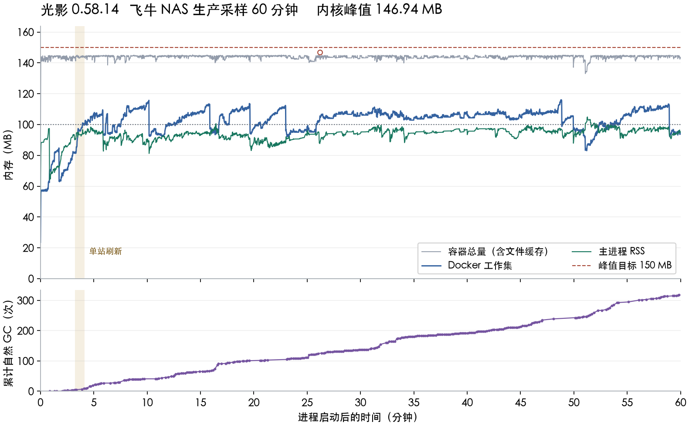

# 飞牛 NAS 光影内存验证（2026-11-23）

## 测量口径

以下内存使用十进制 MB。进程列读取 Linux 的 VmRSS 和 VmHWM。容器工作集沿用 Linux Docker CLI 的口径，从 memory.current 减去 inactive_file。另列包含可回收文件缓存的原始内核峰值 memory.peak。Go 的 NumGC 包含强制回收，表内另行列出强制次数。GC 频率按同一进程内计数差和实际时间差计算。不同生产窗口的站点响应和调度负载会有差异。22:12 直接执行 docker stats，光影显示 101.1 MiB（106.01 MB），容器运行正常，重启计数为 0。[Docker 内存统计口径](https://docs.docker.com/reference/cli/docker/container/stats/)

## 0.58.14 的 60 分钟实测

北京时间 21:34:19 至 22:34:19，在同一个运行进程中取得 3,602 个容器读数。Docker 工作集中位 **105.09 MB**，95 分位 111.28 MB，采样最高 116.07 MB。主进程 RSS 中位 **94.44 MB**，内核记录的进程峰值 104.95 MB。包含所有计入容器的文件缓存时，中位 144.27 MB，内核记录的生命周期峰值为 **146.94 MB**。交换用量和 OOM 事件均为零。

| 运行时段 | Docker 工作集中位 MB | 主进程 RSS 中位 MB | 最近一次 GC 后活堆中位 MB | 自然 GC 次/分 |
|---|---:|---:|---:|---:|
| 第 0–15 分钟 | 100.03 | 91.65 | 22.67 | 4.63 |
| 第 15–30 分钟 | 104.91 | 92.90 | 21.88 | 4.84 |
| 第 30–45 分钟 | 106.11 | 95.72 | 21.88 | 5.06 |
| 第 45–60 分钟 | 106.37 | 96.42 | 28.62 | 7.00 |

自然 GC 的有效读数覆盖 59 分 1 秒（21:35:10 至 22:34:11），计数从 12 至 330，增加 318 次，平均 **5.39 次/分钟**，进程累计强制 GC 为 0。分配速率 0.99 MB/s。内存健康接口与应用共享数据库连接，间隔内有 87 次探测失败，其中 1 次连接错误、4 次启动期间的 HTTP 503、82 次超过 8 秒。GC 使用成功读数的累计差值，内核内存采样独立进行。采样结束时，同一进程的完整健康接口用时 23.28 秒返回，构建标识正确，自动调度运行正常，启用插件 13 个，活跃订阅 4 个。当时累计 333 次 GC，强制 GC 为 0。



### 同期业务

窗口内有 4 条订阅检查成功完成。结束时另有 1 条正在运行、1 条排队。启动后正确读取了 17 个站点和 4 个订阅。第 55 分钟复测时仍返回 17 个站点，订阅列表返回 HTTP 504。测试站点的账户刷新成功，返回更新的检查时间和规范的注册日期。首页 HTML 的七次定时读取都校验了页面内容；入口脚本和 CSS 另已完整读取。

| 任务列表复测 | 业务结果 | 端到端秒数 |
|---|---|---:|
| 启动后 | 100 条 | 12.10 |
| 第 10 分钟 | HTTP 504 | 32.27 |
| 第 20 分钟 | HTTP 504 | 70.44 |
| 第 28 分钟 | 100 条 | 10.70 |
| 第 35 分钟 | 100 条 | 11.245 |
| 第 55 分钟 | HTTP 504 | 32.45 |

六次任务列表复测中有 3 次未在接口时限内返回结果。在第 20 分钟附近，整机 I/O full 的 10 秒均值约 79%。对光影线程做 150 次逐秒观察，其中 185 个线程样本等待块设备请求，140 个线程样本等待文件页。两类等待有 18 个样本位于数据库 pread 调用中；独立读取内核栈也确认了文件缺页等待。第 28 和 35 分钟，同一接口分别用时 10.695、11.245 秒，返回了完整 100 条任务。此次内存目标的验收范围是上述版本、部署设置和实际负载窗口。

## 插件页和刷流页为何变慢

11 月 23 日 22:52 至 23:04，在同一生产进程上对照资源组的回收阈值。Go 堆目标、GOGC、程序版本和插件配置保持一致。每轮用独立的内网 HTTP 连接并发读取相同的首页、健康接口、已安装插件和刷流状态。成功的业务响应分别核对了 18 个插件和 3 个任务。单项请求的客户端时限为 40 秒。

| 临时回收阈值与测试顺序 | 插件列表秒数 | 刷流状态秒数 |
|---|---|---|
| 145 MB，最初两轮 | 两次超过 40 | 两次超过 40 |
| 195 MB，连续三轮 | 33.40、0.35、4.61 | 39.66、1.72、28.29 |
| 恢复 145 MB | 31.78 | 超过 40 |
| 170 MB，连续三轮 | 8.64、12.96、2.39 | 12.01、17.97、3.07 |
| 回到原设置后，临时试 148 MB，连续三轮 | 1.97、1.60、5.15 | 5.90、3.37、6.79 |
| 最后恢复 145 MB | 12.98 | 22.97 |

在最初两轮均超时期间，健康接口的累计 GC 两次均为 465。第 2 轮前后约 41 秒，光影进程实际读盘增加 120.41 MB，容器增加 5,248 次主缺页。放宽阈值后，已进入内存的数据有机会被下一轮直接复用。各轮的操作系统缓存温度和整机 I/O 压力仍有差异。148 MB 的三轮紧接之前的预热，不能据此判断长期比 170 MB 更快。另取十秒样本，承载光影数据的机械盘忙碌 91.8%，读请求平均 42.41 毫秒。

浏览器里首次打开插件页时，首页文档耗时 19.86 秒，导航和已安装列表两条请求各耗时约 245 秒（请求跨越了第一次调高阈值），随后插件市场又用时 12.45 秒。复用页面后，点击侧栏进入「站点刷流」，一次实测 28.39 秒，状态请求占 24.80 秒。再一次在 145 MB 下点击刷流是 22.91 秒，状态请求占 17.89 秒。返回已加载的插件卡片时，浏览器直接显示 18 张卡片只用 0.32 秒。

在 195 MB 试验期间，生产容器的累计含缓存峰值增加到 195.38 MB。此前一小时的 146.94 MB 是试验开始前实测值。这一组对照结束时恢复了 145 MB，随后将该轮正式试用值调整为 170 MB。同一进程的历史峰值包含临时试验。

### 170 MB 正式试用

23:22 持久设置生效，沿用原容器及进程。正式试用开始后逐秒采样 3 分钟，181 个读数中，Docker 工作集中位 127.72 MB、采样最高 129.69 MB，主进程 RSS 中位 102.97 MB，含文件缓存的容器总量采样最高 169.82 MB；交换使用为 0，未发生 OOM 杀进程。

新标签首次打开插件页，从开始导航至看到 18 张卡片用时 79.05 秒，已安装列表接口本身用时 52.44 秒。点击侧栏「站点刷流」至状态数据渲染用时 14.21 秒。返回已经加载的插件列表用时 0.70 秒。两轮独立接口测试都核对了 18 个插件及 3 个刷流任务，插件列表分别用时 11.24、29.45 秒，刷流状态分别用时 19.72、30.23 秒。该窗口内首开和后台读取仍有明显延迟。

## 生产基线

| NAS 版本及窗口 | 进程 RSS 中位 / 内核峰值 | Docker 工作集中位 / 采样最高 | 含缓存内核峰值 | GC 每分钟 / 强制次数 | 分配 MB/s |
|---|---:|---:|---:|---:|---:|
| 0.58.7 已预热，5 分钟，每 10 秒一次 | 149.62 / 171.64 | 160.95 / 169.12 | 460.98 | 7.00 / 0 | 3.87 |
| 0.58.8 启动后，11 分钟，每秒一次 | 110.63 / 113.59 | 164.73 / 168.80 | 439.39 | 6.55 / 0 | 1.83 |
| 0.58.10，19 分 35 秒，每秒一次 | 98.63 / 111.62 | 107.33 / 132.05 | 142.06 | 7.31 / 0 | 1.71 |
| 0.58.11，25 分钟，含实际站点刷新 | 118.68 / 141.66 | 118.62 / 138.28 | 141.95 | 174.27 / 0 | 1.69 |
| 0.58.12，25 分钟，含实际站点刷新 | 95.03 / 107.91 | 107.81 / 134.40 | 147.10 | 7.07 / 0（有效 17 分 7 秒） | 1.36 |
| 0.58.13，20 分 47 秒，含实际站点刷新 | 89.45 / 95.69 | 96.91 / 115.11 | 142.05 | 7.10 / 0 | 1.25 |
| 0.58.14，60 分钟，含实际站点刷新与订阅任务 | 94.44 / 104.95 | 105.09 / 116.07 | 146.94 | 5.39 / 0 | 0.99 |

0.58.8 窗口内活跃文件页中位为 82.64 MB。0.58.9 先在原容器设置下运行，真实订阅搜索时，Docker 工作集再次超出 150 MB。针对正在运行的实例临时设置 125 MB 的 memory.high 并禁止该容器换页，一次采样的工作集降至 98.70 MB，但业务首页与内存接口都曾经等待超过 20 秒。随后恢复原设置。同期 NAS 整机 IO 压力很高，原设置下健康接口也曾超时。

## 应用修改

1. 文件删除保护过去会反复解码 1,923 项资产约 16.84 MB 的 JSON，以及 2,012 项受管文件。现在 SQLite 事务触发器维护版本号，Go 端复用同一版本的归属路径和资产状态。每次操作仍在事务内核对进行中的整理计划，并重新检查实际文件身份。文件被替换、资产变化和事务回滚均有回归覆盖。
2. 刷流插件复用同一促销页的 Unicode 解码结果，减少可证明不会匹配的正则回溯。两个约 156 KB 的样本中，命中靠后优惠和无优惠的分配分别从 21.45、19.66 MB 降到 6.42、4.68 MB。下载任务枚举样本从约 3.98 MB 降到 2.58 MB。IYUU 在准备选中种子的哈希列表时只复制一次；仅用于校验响应形状时跳过未使用的字段。
3. 启动时逐条读取旧资产并补齐季集索引；按目录读取已索引的观察项；按需加载插件翻译、Mako 字符表和正则。SQLite 保留单写、四路并发读、一个空闲读连接，每连接页缓存预算为 1 MiB。校验大型插件文件时保持全量 SHA-256 读取，Linux 支持时使用 RWF_DONTCACHE，旧内核走普通读取。Go 默认软目标 56 MiB、GOGC 200；已有环境变量仍优先。[Linux readv(2)](https://man7.org/linux/man-pages/man2/readv.2.html)
4. 0.58.9 的一次真实搜索堆采样中，反复构建季集集合及排序比较中的评分合计约 109 MiB。0.58.10 在 1–9999 的合法集号范围内使用局部位图，让季集映射复用已验证的集合，并对每个候选按当前策略计算一次排序分数。350 集样本连续 200 次执行，同一合法资源的分配从 72,820 降至 937 B/op，耗时从 63.7 降至 9.8 微秒。
5. 0.58.10 的生产库有 11,447 条任务。旧版队列索引把 retry_wait、waiting_paused 也计入活跃状态；查询表达式早已更新，SQLite 的 CREATE INDEX IF NOT EXISTS 却保留了同名旧表达式。EXPLAIN 证实每次要扫描 jobs 并建临时排序树。0.58.11 先按当前表达式建版本化索引，再清除旧索引。相同规模的本地合成库前 100 条 ID 和顺序逐项相同；十次热查询中位从 2.87 ms 降至 0.029 ms，按每 100 条虚拟机指令计数，从约 198,600 条降至约 500 条。站点页面检查 CSS 类名改为遍历 Unicode 空白分隔的字段。

## 刷新站点时的 GC 峰值

0.58.11 的实机堆栈定位到了测试站点的账户日期解析。19:38 后，活堆在一次 15 秒采样间隔内从 20.7 MB 升至 49.4 MB，增加 67 次 GC；接下来的 10 秒仅分配了约 4 MB，却又触发 33 次 GC。一份随后取得的 Go 堆采样中，日期库的语言加载路径持有约 33.4 MiB。源码确认首次查一种语言就会构建全部 205 组语言及其区域数据；常用注册时间也会走到这里。仅设置较小的 Go 软限额会放大这种负载的 GC 开销。

0.58.12 按原优先级依次尝试语言，找到有效日期即停止加载。解析器强引用最近八个语言值，仍在使用的语言通过弱引用保持相同对象，字典随语言一起释放。保留 205 组、512 个语言与区域代码；罕见或无法识别的输入仍可遍历完整集合。

NAS ARM64 对照分别启动 0.58.11 和 0.58.12 日期实现，均保留同一块 16 MiB 合成活数据，Go 软限额 56 MiB、GOGC 200、单核。首次解析同一条带 UTC 时区的注册时间，两者得到完全相同的时间；分配由 96.64 MB 降至 6.88 MB，耗时 486 ms 降至 31 ms，自然 GC 从 12 次降至 1 次。为测量留存，每组结束后单独强制收集一次；收集后的活堆含合成数据，从 49.10 MB 降至 20.12 MB。中文、法文和本地时间的结果也逐项相同。无法识别的一条文本触发冷遍历，候选版额外分配 82.15 MB、自然 GC 3 次，收集后只保留 19.62 MB。此项记录了罕见输入的耗时、分配与长期驻留之间的取舍。

## NAS 磁盘预读与 UI 超时

0.58.12 在 140 MB 的资源组软阈值下曾出现任务列表超时。试调到 145 MB 后，站点全量刷新和订阅搜索同时运行，容器内核峰值为 147.10 MB，首页、健康接口却都曾经 15 秒没有响应。此时应用只有约 4.6 MiB 只读执行代码和 2.6 MiB 只读数据仍在物理内存。Linux 线程栈显示文件缺页正在等待 ext4 预读和块设备请求，进程实际磁盘读取约 7.4 GB。宿主磁盘预读配置是 8192 KiB，同期整机 I/O 的 full 压力超过 70%。将光影自己已打开的 SQLite 文件临时标为随机读取后，首页一次响应仍需 7.91 秒，健康接口 20 秒超时。临时放宽到 185 MB 后，首页 0.01 秒、健康接口 0.59 秒恢复，含缓存内核峰值也超过 185 MB。这一段只用于定位问题。

0.58.13 启动时核对自身映像的设备号、inode、映射权限及磁盘预读设置。如果设备预读至少为 8192 KiB，对当前可执行文件的代码和只读数据映射使用 MADV_RANDOM。飞牛系统的磁盘设置和数据库文件不需要额外配置。该提示影响内核的预读策略。 [Linux madvise(2)](https://man7.org/linux/man-pages/man2/madvise.2.html)

NAS 在独占的 31 MB 测试文件上做了四轮冷缓存对照，每次读取同样的 14 个离散页面，每次均核对校验结果。普通预读两轮各读盘 31,133,696 字节，逐页读取两轮各读 57,344 字节。普通预读单轮耗时 1.05 至 1.25 秒，逐页读取为 1.04 至 3.68 秒；这里证实读盘放大量，业务响应另在部署版本上验证。

在同一台 NAS 的临时资源组中，再保留一块 13 MB 的合成活数据，给资源组设置 26 MB 软阈值。相同 14 页连续访问三轮，普通设置实际读盘 298.15 MB、耗时 18.05 秒，内核记录 1,844 次超阈值事件；新版提示实际读盘 57,344 字节、耗时 1.07 秒，超阈值事件为零。两次各轮的内容校验结果完全相同。

0.58.13 在 NAS 的独占实例逐项验证了 840 个目录观察和 1,000 个请求，峰值 RSS 80.79 MB、自然 GC 3 次、强制 0 次。Linux smaps 的 rr 标记和原生单测均核对了仅选择匹配映像的可执行和只读映射。

## 任务列表的重复读取

0.58.13 的真实页面中，站点注册日期正常，任务列表却曾返回 504。用与应用相同的 Go SQLite 驱动、相同读缓存访问生产库，确认用了新的排序索引。前 100 行中有 95 条订阅任务，只关联 4 个订阅。旧查询仍会为每条任务提取完整的关联记录，并在最终排序和驱动返回时反复复制这些数据。

0.58.14 在已经选出的最多 100 行中，按任务类型和载荷中的关联 ID 确定每组的代表行。只为代表行查询关联记录，其他行在内存中复用该记录。每条任务按自己的 ID 取最新事件，保留独立的状态、顺序和摘要。历史清理的旧资产查询只读取清理记录。同一 SQLite 只读事务内，用新旧查询对照 100 行，每行的原始字段、关联载荷、最新活动和顺序均验证相同。实际传输的列数据从 2,194,736 降至 121,576 字节；首次对照的 Go 分配从 4.72 MB 降至 0.33 MB。重复执行时新旧查询分别用时 8、67 毫秒。此处为生产库查询耗时，页面的端到端耗时另计。

## 已完成的回归

在 NAS ARM64 的独占合成数据库中，每个候选版本都校验了 840 个目录观察及 1,000 个请求。0.58.10、0.58.11、0.58.12 的进程峰值分别为 70.41、67.00、70.00 MB，负载期间分别有 4、3、3 次自然 GC，强制回收均为 0。生产验证单独计量。真实运行未主动触发下载、删除或整理。

日期库完整测试（含生成工具）、语言顺序和并发淘汰 race、光影站点适配器测试通过。本机另以相同 16 MiB 常驻合成数据，连续校验 1,010 个多语言日期和无效输入。分十批测量，每批额外执行一次诊断 GC 后活堆均为 19.64 MB，首尾相差 48 字节。

0.58.14 的相同隔离实例校验了 840 个目录观察和 1,000 次健康读数，进程峰值 91.41 MB、自然 GC 4 次、强制 0 次。任务列表与详情一致性、重复对象保留独立活动、任务分页及旧库索引升级用例通过，全部任务摘要、队列和共享对象用例均通过普通测试和竞态检测。

季集和映射包通过测试及竞态检测。通过的回归还包括促销正则的 CPython 对照、Mako、文件引用失效和回滚、SQLite 读池、按策略重排和稳定平局、自动整季包、并发搜索取消和部分结果。已有宿主回归里，下载清理对 retry_wait 的取消断言、站点优先级配置重排、质量订阅整季包的 SQL 错误均在对应优化前代码上复现。0.58.11 的在盘升级回归和竞态检测通过。旧的订阅列表索引断言也在替换索引前的版本复现。两处任务摘要测试直接修改配置后，现已同步使设置缓存失效，测试覆盖的设置与其输入一致。完整项目测试通过率不能由本次定向回归推出。

## NAS 上的实际部署

0.58.14 于北京时间 21:34 在原容器启动，构建标识为 `nas-memory-queue-refs-20261123`。从运行进程读回的 SHA-256 为 `28182dc53f3511f26210b0e17d4517ff24282195c82ceefc7bb48e9dd0c76e8e`。已核对 18 个已加载插件、13 个已启用插件、17 个调度项、4 个活跃订阅、840 项启动对账记录。内存接口返回的实际 Go 软目标为 58,720,256 字节，GOGC 为 200；应用映射的代码、只读数据均带有 rr 标志。首页的入口脚本与 CSS 均已读完整，并通过内容类型校验。

0.58.14 再次通过同一测试站点的卡片执行同一账户刷新。返回连接成功、检查时间已更新、注册日期格式正常，端到端 54.41 秒。同期整个进程活堆从 20.67 增至 23.65 MB，自然 GC 4 次、强制 GC 0 次。随后在 21:43 采集的堆分配样本中，带日期库调用栈的存活分配为 1.60 MiB。

0.58.12 于北京时间 20:30 在 NAS 原服务启动，构建标识为 `nas-memory-locales-20261123`。已核对运行进程 SHA-256 为 `f05e577e709779148f70642951ac6e156c5882357334dc4ecb7b6ad32846760b`。应用实际载入 18 个插件、启用 13 个，返回 17 个插件调度项、4 个活跃订阅。启动对账检查了 840 个观察项，随后正常调度了订阅搜索。

对同一测试站点，通过站点卡片接口刷新了一次账户。连接状态为成功，检查时间前移，返回注册日期，端到端耗时 23.88 秒。期间有刷流及订阅任务并行，整个进程活堆由 20.07 变为 20.84 MB，7 次自然 GC、强制 0 次。20:35 获取的堆采样显示，日期库关联的存活分配约 0.50 MiB，其中采样栈指向时区初始化；0.58.11 单是首次日期解析的加载栈就占 33.37 MiB。对应生产堆文件经应用的鉴权只读接口采集。

0.58.10 的 SHA-256 为 `6102ac2b307260a06d9c8dadf628b56f033c20849fa5803e55f97050962f2d7a`，构建标识为 `nas-memory-decisions-20261123`。部署时等到运行中持久任务为零，核对了当前镜像 ID、只读根文件系统、11 个挂载及现有 Compose 配置哈希。按原镜像重建了光影这一项服务，已从运行进程读回可执行文件并核对 SHA-256。

此次 NAS 试验的 systemd 资源组使用以下设置。对应的 Compose 服务指定 `cgroup_parent: lightmedia.slice`。内核对该组所有进程与文件缓存执行软回收；该组禁止交换，Docker 的硬限仍为 512 MiB。Compose 和 systemd 单元均写入持久配置。前述一小时采样使用 145,000,000 字节。23:22 将该轮正式试用值调为 170,000,000 字节；重新加载 systemd 后，已分别读回持久配置、管理器属性及内核生效值（169,996,288 字节）。光影进程 PID 与调整前相同。本次已验证容器重建，未重启整台 NAS。memory.high 是回收和节流阈值，负载突发时可以越过阈值。 [Linux 内核 cgroup v2 文档](https://docs.kernel.org/admin-guide/cgroup-v2.html#memory-interface-files)

```ini
[Unit]
Description=Memory budget for the light-media Docker container

[Slice]
MemoryAccounting=yes
MemoryHigh=170000000
MemorySwapMax=0
```
