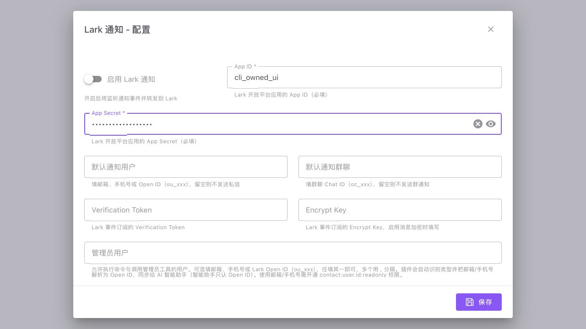

# Lark 原版密码显隐交互

正式表单渲染器将 LarkMessager 0.9.1 原 App Secret 字段的类型表达式、眼睛图标和点击函数，映射成同一项原生显隐动作。仅当四个原属性完整匹配时才启用；不执行任意 JavaScript，不把其他动态表达式当作已移植。

原始安装源码 SHA256 `d9f6a1078706b03dc97247450a8084a8c67f07dbfccb675235fc0e1b91b18372`，get_form 片段 SHA256 `a55877576b9fba09454e7e2a9331aa51bfd9cdf5153cfe78f85b9604d6e7d361`。原作者 ui-beam-9。完整表单和默认值保存于 `testdata/plugins/lark-messager-0.9.1-form.json`；来源是离线执行原 get_form 的参考结果，未包含用户配置或凭据。旧 cached-source-manifest 的脱敏计数不用于判定新读取的 raw source。

浏览器使用实际 PluginConfigDialog、原表单和内存 HTTP：输入合成值，点击两次，input.type 按 password→text→password 变化；从遮蔽状态保存仅产生一次请求，接收端确认原输入未变，显隐标志为 false。浏览器工具对密码 DOM 值做脱敏，不能用它的遮蔽读值判断数据丢失；实际提交布尔断言证明原值仍在。没有访问 Lark、真实账号或用户密钥。

原表单的 rules 是对象数组，当前 Vuetify 与原 FormRender 的直接传递方式会产生规则类型 warning。本次如实保留这 6 条控制台 warning，没有把它们隐藏或自创另一套验证器；**不据此宣称 required 已在前端生效**。页面无 error，保存成功。见 [浏览器记录](plugin-lark-password-ui-verification.json)。

前端全部 142 项测试通过，类型检查和构建成功，dist 及本地图标已更新。新增测试验证原表单、值保持、真实 Vue 响应式更新，以及变造函数/表达式仍被拒绝。临时页面和 Vite 进程已关闭。

这仅完成该原表单的显隐交互；Lark 业务仍在独立 Go 候选验证，未正式注册、导入配置或部署，不代表该插件整体已可使用。

