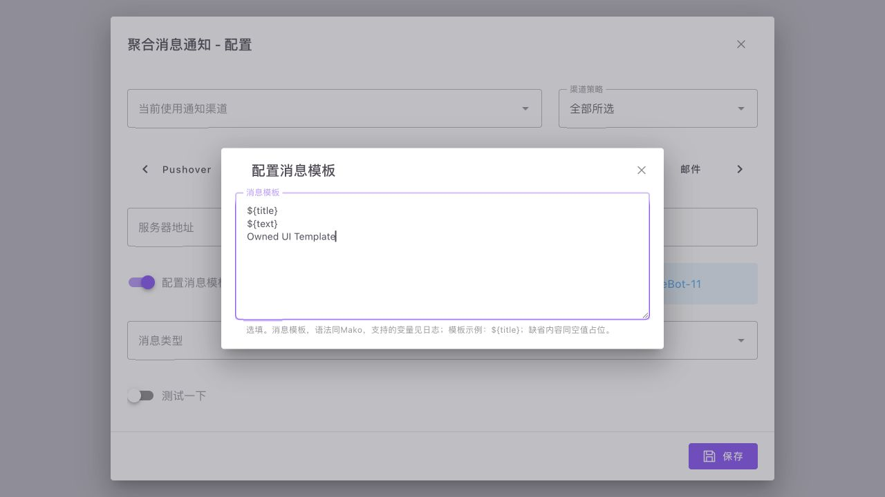

# 聚合通知：原版配置表单交互

正式表单渲染器补充原版 VTabs/VTab、VWindow/VWindowItem、VDialog/VDialogCloseBtn、VCard 与普通链接。配置键按原版 `model[value]` 作为字典的**完整字面键**处理，支持 `_tabs`、`custom.onebot-11.*` 等，不转成嵌套配置。未知动态脚本/HTML 仍报告未移植，不执行服务端字符串。

关闭子弹窗按原版同时发出 `update:modelValue(false)` 与 click；主表单和其他渠道草稿保留。链接仅接受无账号密码的 HTTP(S)，新窗口附带 noopener/noreferrer。原型键不可绑定。缺失键也必须先读取响应式属性再核对 own-key，否则首次选择页签或首次打开子弹窗不会重绘；浏览器验证发现并修复了这一问题。

参照本地原版 Frontend 的 FormRender.vue（SHA256 `8a2641a7cb06242d6a43a80939f9bccb2a00948454f62347ab0c6cf990a41ccc`）及 DialogCloseBtn.vue（`9c8c33863c9e685809fc9c01dc6436b6d87f874c4d314af4a48530d88f3828a9`）。沿用当前与原版一致的 Vuetify 3.7.3、浅色主题和控件默认值，不增加渠道向导或额外保存步骤。

验证使用实际 PluginConfigDialog 和正式原 get_form 结果：18 份表单共 655 个节点通过 whitelist 检查。浏览器在隔离 Vite 页面使用内存 fetch，首次默认选中爱语飞飞，切换 Bark→邮件→OneBot-11→Bark；修改 Bark 分组/加密 CBC、邮件主机/署名和多行模板，关闭两个子弹窗，再保存仅产生一次请求，原点号键和所有跨渠道草稿准确保留。没有执行通知发送。最终控制台无 warning/error，页面错误为空。见 [交互记录](plugin-merge-message-form-ui-verification.json)。

前端全部 **141 项测试通过，0 跳过/失败**；类型检查及正式构建成功，dist 已重建。现有图表大 chunk 的 Vite 体积提醒保留，不是本批运行错误。新增回归测试用实际 Vue reactive/effect 核对缺失键的首次更新，不仅验证赋值函数。

截图是隔离验证页面，**聚合通知尚未注册、部署或导入用户配置**；模板编辑器可用也不代表完整 Mako/Apprise 已实现。原始模板提示和字段保留，尚未完成的后端依赖继续见 [Go 主流程](plugin-merge-message-go-port.md)。临时 Vite 进程、浏览器页签已关闭，夹具移入 ignored work 目录。

